# Screen and Form Reference

**Distribution Management System — Desktop Application for Windows**

This reference describes every screen of the application, one screen at a time. For each screen you will find:

- what the screen is for and how to open it,
- a screenshot of the real application,
- what every button, box and list column does,
- a field-by-field table for every form,
- what happens after you save, and which other screens are affected.

For step-by-step business procedures (for example "receive a delivery and sell it"), see [WORKFLOW_GUIDES.md](WORKFLOW_GUIDES.md). For error messages, see [TROUBLESHOOTING.md](TROUBLESHOOTING.md).

> **About the screenshots.** All screenshots were captured from the real running application using **made-up example data** (for example "Sunrise Foods", "Al-Madina General Store"). Any resemblance to real businesses is accidental. Figure numbers match the image file numbers, for example *Figure 25* is `25-products-list.png`. Figures ending in "a" (for example *Figure 25a*) are copies of the same screenshot with red numbered markers added.

---

## Contents

1. [Sign-in Window](#1-sign-in-window)
2. [Main Window and Navigation](#2-main-window-and-navigation)
3. [Dashboard](#3-dashboard)
4. [Companies](#4-companies)
5. [Categories](#5-categories)
6. [Products](#6-products)
7. [Customers](#7-customers)
8. [Suppliers](#8-suppliers)
9. [Opening Stock](#9-opening-stock)
10. [Stock Received](#10-stock-received)
11. [Damage Entry](#11-damage-entry)
12. [Party Billing](#12-party-billing)
12a. [Receive Payment](#12a-receive-payment)
13. [Party Ledger](#13-party-ledger)
14. [Market Credit](#14-market-credit)
15. [Expense Entry](#15-expense-entry)
16. [Expense Report](#16-expense-report)
17. [Daily Closing Stock](#17-daily-closing-stock)
18. [Daily Sale Report](#18-daily-sale-report)
19. [Profit & Loss](#19-profit--loss)
20. [Damage Report](#20-damage-report)
21. [Users](#21-users)
22. [Settings](#22-settings)
22a. [Notifications Window](#22a-notifications-window)
22b. [Software Update Window](#22b-software-update-window)
22c. [Locked Screen](#22c-locked-screen)
23. [Common Controls Used on Many Screens](#23-common-controls-used-on-many-screens)

---

## 1. Sign-in Window

### Overview

| | |
|---|---|
| **Window title** | Sign in — Distribution Management System |
| **Purpose** | Confirms who you are before the application opens. |
| **Who uses it** | Everyone. |
| **What you can do** | Enter your username and password, show or hide the password, and sign in. |

### How to open it

1. Double-click the **Distribution Management System** icon (or the program file `Distribution.WinForms.exe`) supplied by your administrator.
2. The Sign-in window appears in the middle of the screen.

### Screenshot

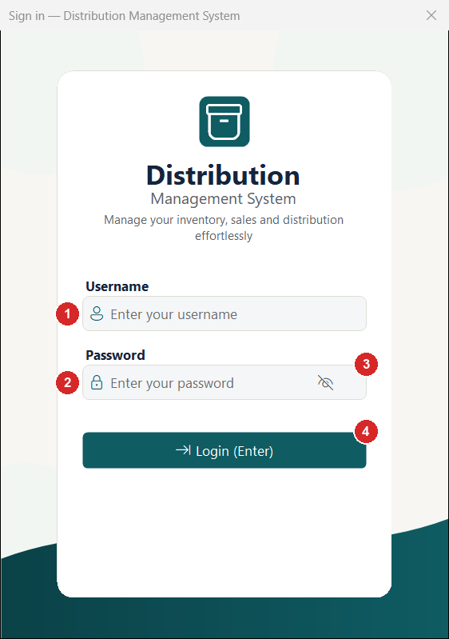

**Figure 1a: Sign-in window (numbered).** Unmarked original: [Figure 1](assets/screenshots/01-login-screen.png).

| No. | Control | What it does |
|---|---|---|
| 1 | **Username** box | Type your username exactly as the administrator created it. Usernames are case-sensitive: `Operator1` and `operator1` are different. |
| 2 | **Password** box | Type your password. The characters are hidden as dots. |
| 3 | Eye icon | Click to show the password as normal text. Click again to hide it. Use this to check for typing mistakes. |
| 4 | **Login (Enter)** button | Checks your username and password. If they are correct, the main window opens. You can also press **Enter** while the cursor is in the Password box. |

### What happens next

- **Correct username and password:** the Sign-in window closes and the main window opens on the **Dashboard** (see [Section 2](#2-main-window-and-navigation)).
- **Wrong username or password:** the red message **"Invalid username or password."** appears under the Password box (Figure 2). Nothing else happens; correct your entry and try again.
- **Deactivated account:** shows the same message, "Invalid username or password." Ask your administrator to activate your account (see [Users](#21-users)).
- **Closing the window** with the **X** button closes the application without signing in.

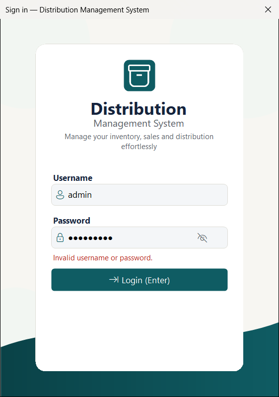

**Figure 2: Message shown when the username or password is wrong**

> **Note:** Pressing **Enter** while the cursor is in the **Username** box does not sign you in. Press **Tab** to move to the Password box, then press **Enter**.

> **First-time use:** When the application is started on a brand-new, empty database, it automatically creates one administrator account. See [Getting Started in USER_MANUAL.md](USER_MANUAL.md#4-system-access-and-getting-started) for the first sign-in and the mandatory password change.

---

## 2. Main Window and Navigation

### Overview

After you sign in, the main window opens maximised (it fills the screen). It has three areas: the **side menu** on the left, the **top bar**, and the **work area** where screens appear.

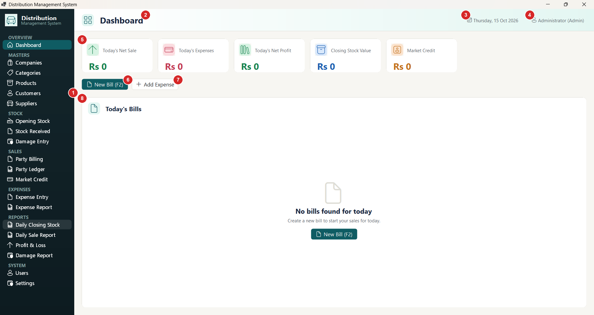

**Figure 3a: Main window layout (numbered)**

| No. | Area | Description |
|---|---|---|
| 1 | **Side menu** | Lists every screen, grouped under headings: OVERVIEW, MASTERS, STOCK, SALES, EXPENSES, REPORTS and SYSTEM. Click a name to open that screen. The screen you are on is highlighted in green. |
| 2 | **Screen title** | Shows the name of the open screen and a short description under it. |
| 3 | **Today's date** | The current date as set on your computer, for example *Thursday, 15 Oct 2026*. A **bell** appears to its left once your supplier has sent a message; see [Notifications Window](#22a-notifications-window). |
| 4 | **Signed-in user** | Your full name and role, for example *Administrator (Admin)*. |
| 5–8 | Dashboard contents | See [Dashboard](#3-dashboard). |

### Side menu items

| Group | Menu item | Opens |
|---|---|---|
| OVERVIEW | Dashboard | [Dashboard](#3-dashboard) |
| MASTERS | Companies | [Companies](#4-companies) |
| | Categories | [Categories](#5-categories) |
| | Products | [Products](#6-products) |
| | Customers | [Customers](#7-customers) |
| | Suppliers | [Suppliers](#8-suppliers) |
| STOCK | Opening Stock | [Opening Stock](#9-opening-stock) |
| | Stock Received | [Stock Received](#10-stock-received) |
| | Damage Entry | [Damage Entry](#11-damage-entry) |
| SALES | Party Billing | [Party Billing](#12-party-billing) |
| | Receive Payment | [Receive Payment](#12a-receive-payment) |
| | Party Ledger | [Party Ledger](#13-party-ledger) |
| | Market Credit | [Market Credit](#14-market-credit) |
| EXPENSES | Expense Entry | [Expense Entry](#15-expense-entry) |
| | Expense Report | [Expense Report](#16-expense-report) |
| REPORTS | Daily Closing Stock | [Daily Closing Stock](#17-daily-closing-stock) |
| | Daily Sale Report | [Daily Sale Report](#18-daily-sale-report) |
| | Profit & Loss | [Profit & Loss](#19-profit--loss) |
| | Damage Report | [Damage Report](#20-damage-report) |
| SYSTEM | Users | [Users](#21-users) (shown to **Admin** users only) |
| | Settings | [Settings](#22-settings) |

### Important behaviour when moving between screens

> **Screens reload when you open them.** Each time you click a screen in the side menu, it reloads its lists and drop-downs from the database. A company, category, product, customer, supplier or area added on one screen is available on the others straight away — **no restart is needed**.
>
> - Whatever you typed is kept while you switch screens and come back, so a half-finished bill is not lost.
> - Your current selection is kept where it still exists. If the record you had chosen has since been deleted, the first item in the list is selected instead, so **check the selection before saving**.
> - **Report results are not recalculated on their own**, because they depend on the dates and filters you choose. Click **View Report**, **View Ledger** or **Apply Filter**.
>
> Lists also reload after you save on the same screen. See [TROUBLESHOOTING.md](TROUBLESHOOTING.md#2-information-looks-out-of-date) if something still looks out of date.

### Signing out and switching users

There is **no Sign out or Logout button**. To finish your work or switch to another user:

1. Click the **X** (Close) button at the top-right corner of the main window. The application closes.
2. Start the application again. The Sign-in window appears and you can sign in as any user.

### Window behaviour

- The window cannot be made smaller than 1366 × 768 pixels.
- Several screens are taller than the window (for example Party Billing and Daily Sale Report). Use the mouse wheel or the scroll bar on the right of the work area to see the lower parts.

---

## 3. Dashboard

### Overview

| | |
|---|---|
| **Screen title** | Dashboard |
| **Purpose** | The first screen after sign-in, with shortcut buttons to create a bill or an expense. |
| **Who uses it** | Everyone. |

### How to open it

It opens automatically after sign-in. At other times, click **Dashboard** under **OVERVIEW** in the side menu.

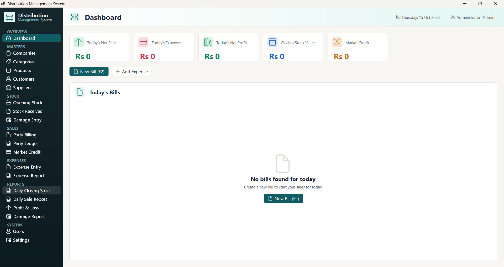

**Figure 3: Dashboard**

### Controls

| Control | What it does |
|---|---|
| **Today's Net Sale**, **Today's Expenses**, **Today's Net Profit**, **Closing Stock Value**, **Market Credit** cards | Summary cards. **In this version these cards always show "Rs 0"**, even after bills, expenses and stock have been recorded (Figure 91). Use the report screens for real figures (see the table below). |
| **New Bill (F2)** button | Opens the [Party Billing](#12-party-billing) screen. (The **F2** key itself does not work; click the button.) |
| **Add Expense** button | Opens the [Expense Entry](#15-expense-entry) screen. |
| **Today's Bills** panel | Always shows **"No bills found for today"** in this version, even when bills exist (Figure 91). The **New Bill (F2)** button inside it also opens Party Billing. |

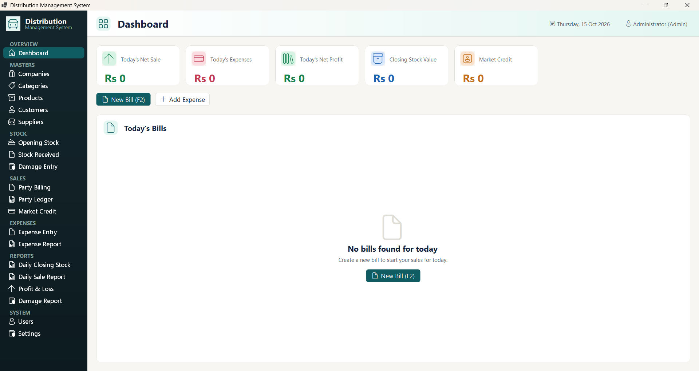

**Figure 91: Dashboard after three bills and three expenses were saved on the same day. The figures do not change.**

**Where to find the real figures:**

| Dashboard card | Use this screen instead |
|---|---|
| Today's Net Sale | [Daily Sale Report](#18-daily-sale-report) or [Profit & Loss](#19-profit--loss) (From and To = today) |
| Today's Expenses | [Expense Report](#16-expense-report) or the **Today's Expenses** list on [Expense Entry](#15-expense-entry) |
| Today's Net Profit | [Profit & Loss](#19-profit--loss) |
| Closing Stock Value | [Daily Closing Stock](#17-daily-closing-stock) (**Value** column) |
| Market Credit | [Market Credit](#14-market-credit) |
| Today's Bills | **Today's Bills** list at the bottom of [Party Billing](#12-party-billing) |

---

## 4. Companies

### Overview

| | |
|---|---|
| **Screen title** | Companies — *Manage your company records easily* |
| **Purpose** | Keeps the list of manufacturers or brands whose products you distribute (for example "Sunrise Foods"). |
| **Why it matters** | Every product and every supplier must belong to a company. Create companies **first**. |
| **Who uses it** | Admin, Operator, Viewer (see [roles](USER_MANUAL.md#14-user-roles-and-permissions)). |

### How to open it

Click **Companies** under **MASTERS** in the side menu.

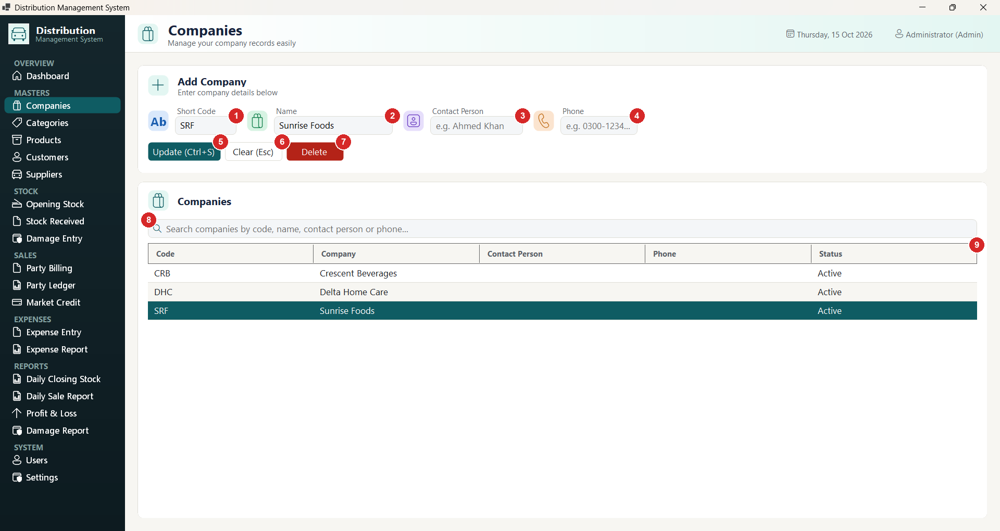

**Figure 9a: Companies screen in edit mode (numbered)**

| No. | Control | Purpose and effect |
|---|---|---|
| 1 | **Short Code** | A short unique code for the company, for example `SRF`. |
| 2 | **Name** | Full company name. |
| 3 | **Contact Person** | Name of your contact at the company (optional). |
| 4 | **Phone** | Contact phone number (optional). |
| 5 | **Save (Ctrl+S)** / **Update (Ctrl+S)** | Saves a new company, or saves your changes when you are editing an existing one. The label changes to **Update** when a company is loaded from the list. |
| 6 | **Clear (Esc)** | Empties the form and leaves edit mode. Nothing is saved or deleted. |
| 7 | **Delete** | Deletes the company that is loaded in the form. It only works in edit mode; otherwise clicking it does nothing (the button looks the same in both cases). |
| 8 | Search box | Filters the list as you type. **Searches by code and name only**, even though the hint text also mentions contact person and phone (see Figure 14). |
| 9 | **Companies** list | All companies. Click a row to load it into the form for editing. |

> **Keyboard shortcuts shown on buttons do not work.** Labels such as *(Ctrl+S)* and *(Esc)* appear on the buttons, but pressing those keys does nothing in this version. Click the buttons with the mouse.

### Form: Add Company

| Field Name | Purpose | Required/Optional | How to Enter the Value | Validation/Restrictions |
|---|---|---|---|---|
| Short Code | Unique short identifier | **Required** | Type text, for example `SRF` | Maximum 20 characters. Must be unique: it cannot repeat the code of **any** company, including deleted ones. A repeated code produces a technical error message (Figure 13). |
| Name | Company's full name | **Required** | Type text, for example `Sunrise Foods` | Up to 200 characters. |
| Contact Person | Your contact at the company | Optional | Type text | Up to 200 characters. |
| Phone | Contact number | Optional | Type text, for example `0300-0000001` | Any text is accepted. There is no format check. Up to 50 characters. |

### List columns

| Column | Meaning |
|---|---|
| Code | The Short Code. |
| Company | The company name. The list is sorted by this name. |
| Contact Person | Contact person, if entered. |
| Phone | Phone, if entered. |
| Status | Always **Active** for companies shown in this list. There is no way to deactivate a company in this version. |

### Screen states

| Figure | State |
|---|---|
| 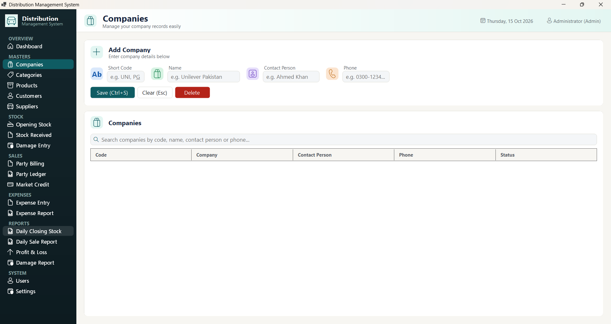 **Figure 4** | Screen when no companies exist yet. |
| 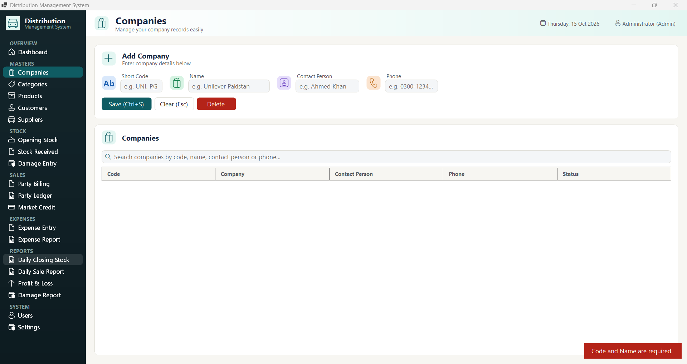 **Figure 5** | Clicking **Save** with an empty Code or Name shows the red message **"Code and Name are required."** at the bottom-right. |
| 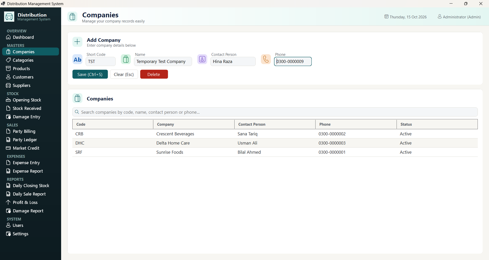 **Figure 6** | Form filled with example data before saving. |
| 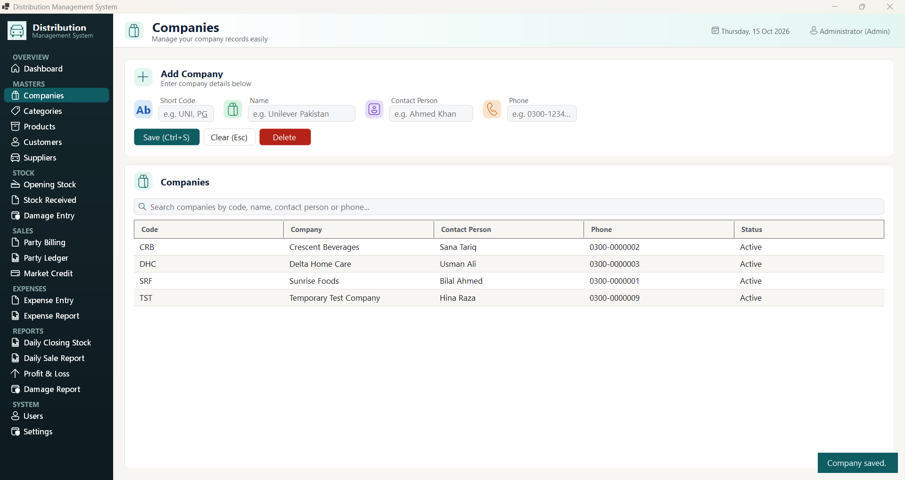 **Figure 7** | After saving: green message **"Company saved."**, the form is cleared, and the new company appears in the list. |
| 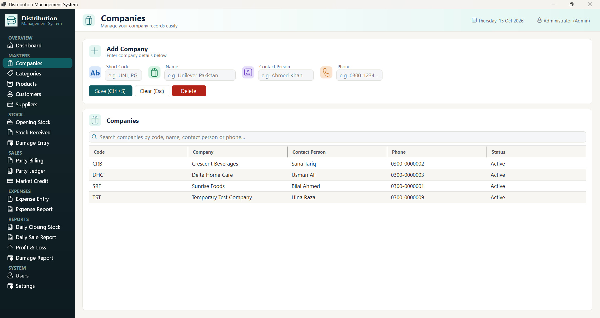 **Figure 8** | The list with four companies after saving. |
| 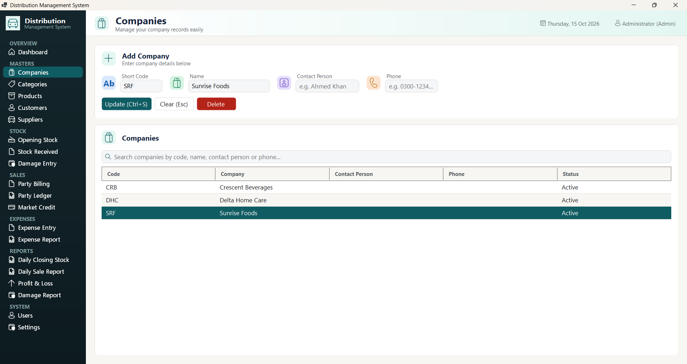 **Figure 9** | After clicking a row: the details load into the form and the button changes to **Update (Ctrl+S)**. |
|  **Figure 10** | After **Update**: green message **"Company updated."** |
| 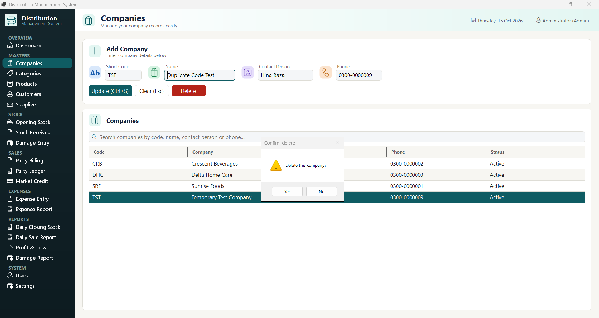 **Figure 11** | Clicking **Delete** asks **"Delete this company?"** with **Yes** and **No**. |
| 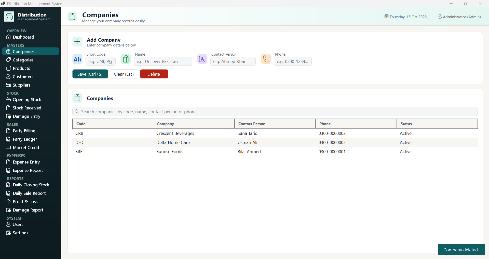 **Figure 12** | After **Yes**: green message **"Company deleted."** and the company disappears from the list. |
| 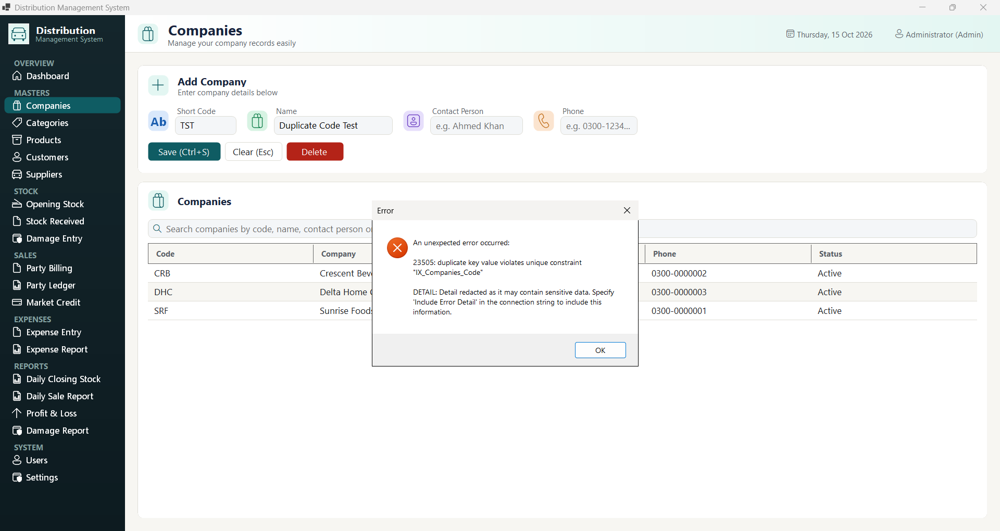 **Figure 13** | Saving a code that already exists (even for a deleted company) shows an **Error** window starting "An unexpected error occurred: 23505: duplicate key value…". Click **OK** and use a different code. |
| 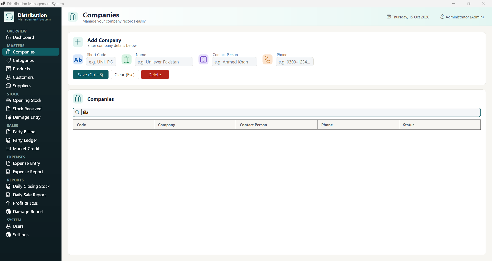 **Figure 14** | Searching by a contact person's name finds nothing. |
| 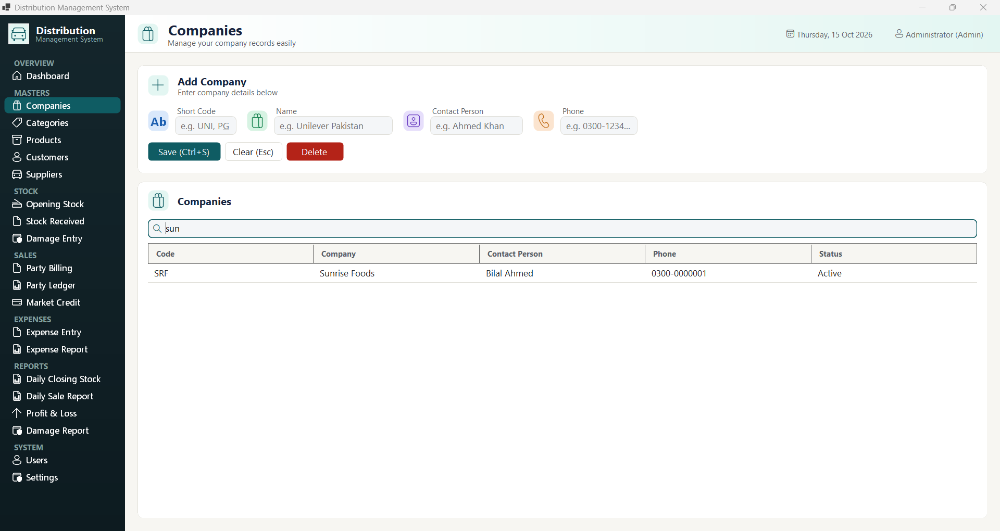 **Figure 15** | Searching "sun" finds *Sunrise Foods*. |
| 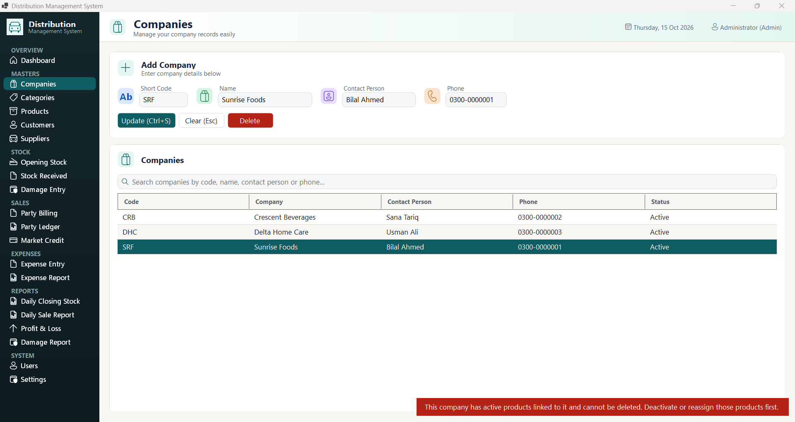 **Figure 33** | A company that still has products cannot be deleted. Red message: **"This company has active products linked to it and cannot be deleted. Deactivate or reassign those products first."** |

### Effects of actions

| Action | Immediate result | Where it appears | Further effects |
|---|---|---|---|
| Save a new company | "Company saved." and the form clears | Companies list | Available straight away in the **Company** drop-downs on Products and Suppliers, and in the company filters on Products and Daily Closing Stock, the next time you open those screens. |
| Update a company | "Company updated." | Companies list | The new name appears on Products, Suppliers and reports the next time they load. |
| Delete a company | Confirmation, then "Company deleted." | Disappears from the list | Blocked if any product or supplier still belongs to the company. The code stays reserved and cannot be reused. A deleted company cannot be restored from the application. |

> **Warning — sorting the list.** Clicking a column heading sorts the list. After sorting, clicking a row can load a **different** company into the form (Figures 107 and 108). Always check the **Short Code** and **Name** in the form before clicking **Update** or **Delete**. See [TROUBLESHOOTING.md](TROUBLESHOOTING.md#3-the-wrong-record-opens-after-clicking-a-row). This applies to every list on the Companies, Categories, Products, Customers, Suppliers and Users screens.

---

## 5. Categories

### Overview

| | |
|---|---|
| **Screen title** | Categories — *Manage product categories for your inventory* |
| **Purpose** | Keeps the product groups (for example Beverages, Snacks, Household). |
| **Why it matters** | Every product must have a category. Create categories before products. |

### How to open it

Click **Categories** under **MASTERS**.

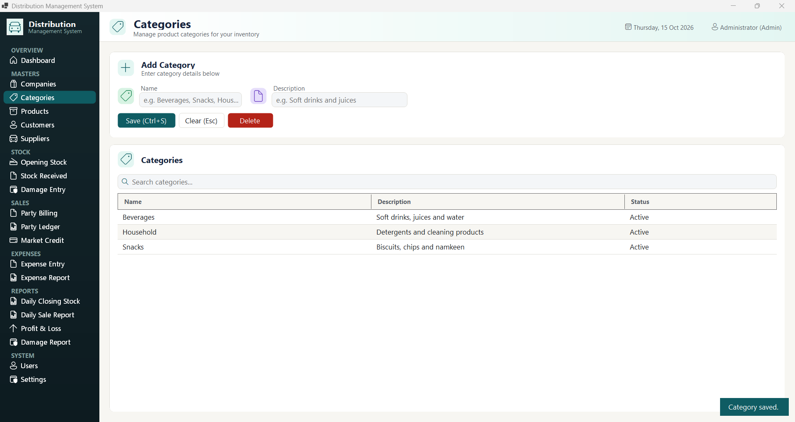

**Figure 19: Categories screen with three categories, just after saving**

### Controls

| Control | Purpose and effect |
|---|---|
| **Name** | The category name. |
| **Description** | Optional notes about what belongs in the category. |
| **Save (Ctrl+S)** / **Update (Ctrl+S)** | Saves a new category or your changes to the loaded one. |
| **Clear (Esc)** | Empties the form and leaves edit mode. |
| **Delete** | Deletes the category loaded in the form (edit mode only). |
| Search box (**Search categories...**) | Filters by category **name**. |
| **Categories** list | Columns **Name**, **Description**, **Status** (always *Active*). Click a row to edit it. |

### Form: Add Category

| Field Name | Purpose | Required/Optional | How to Enter the Value | Validation/Restrictions |
|---|---|---|---|---|
| Name | Category name | **Required** | Type text, for example `Beverages` | Up to 200 characters. Duplicate names are **not** prevented, so check the list first. |
| Description | Explanation | Optional | Type text, for example `Soft drinks, juices and water` | Up to 500 characters. |

### Screen states

| Figure | State |
|---|---|
| 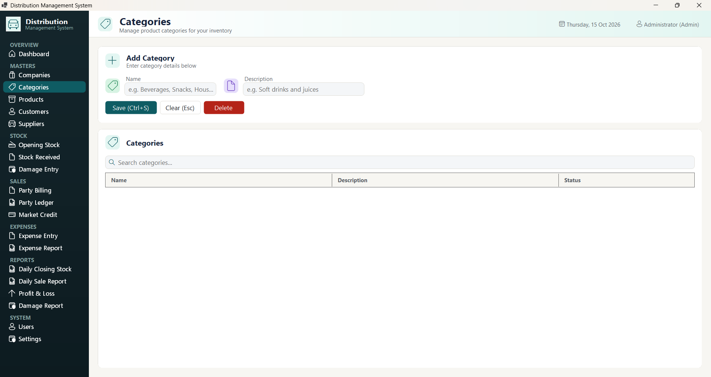 **Figure 16** | No categories yet. |
| 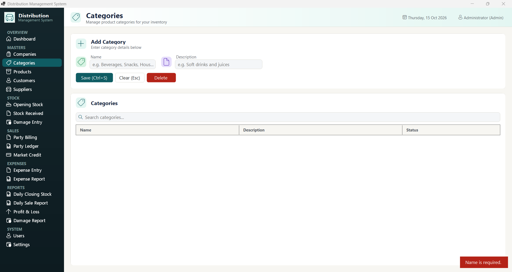 **Figure 17** | **"Name is required."** when Save is clicked with an empty Name. |
| 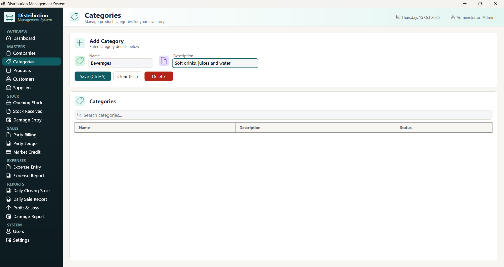 **Figure 18** | Form filled before saving. |
| 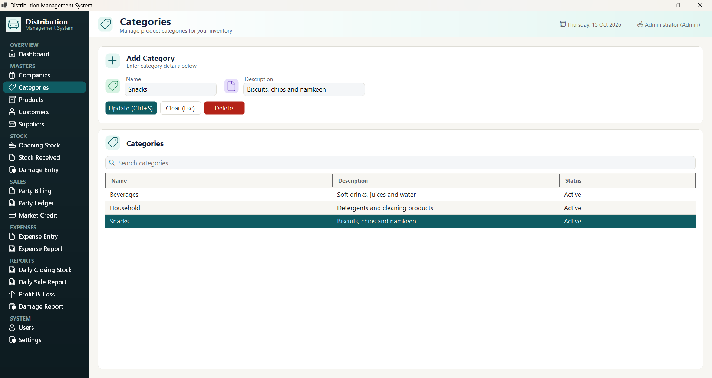 **Figure 20** | Row clicked: the form is in edit mode with **Update (Ctrl+S)**. |
| 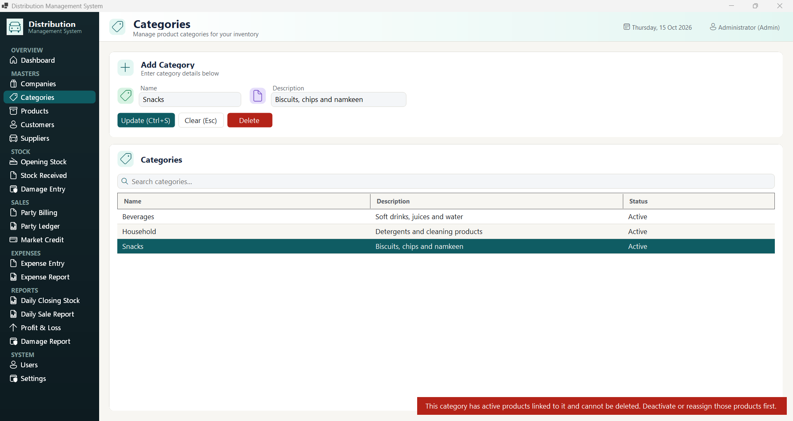 **Figure 32** | Deleting a category that has products: **"This category has active products linked to it and cannot be deleted. Deactivate or reassign those products first."** |

### Messages

"Category saved.", "Category updated.", "Delete this category?" (**Yes**/**No**), "Category deleted."

### Effects of actions

- A new category appears in the **Category** drop-down on Products and in the category filters on Products and Daily Closing Stock the next time you open those screens.
- A category can only be deleted when no product uses it. To delete one that is in use, first move each product to another category (edit the product and change its **Category**) or delete those products.

---

## 6. Products

### Overview

| | |
|---|---|
| **Screen title** | Products — *Add, update and manage your products* |
| **Purpose** | Keeps the list of items you buy and sell, with prices, discount limits and current stock. |
| **Before you start** | At least one company and one category must exist. |

### How to open it

Click **Products** under **MASTERS**.

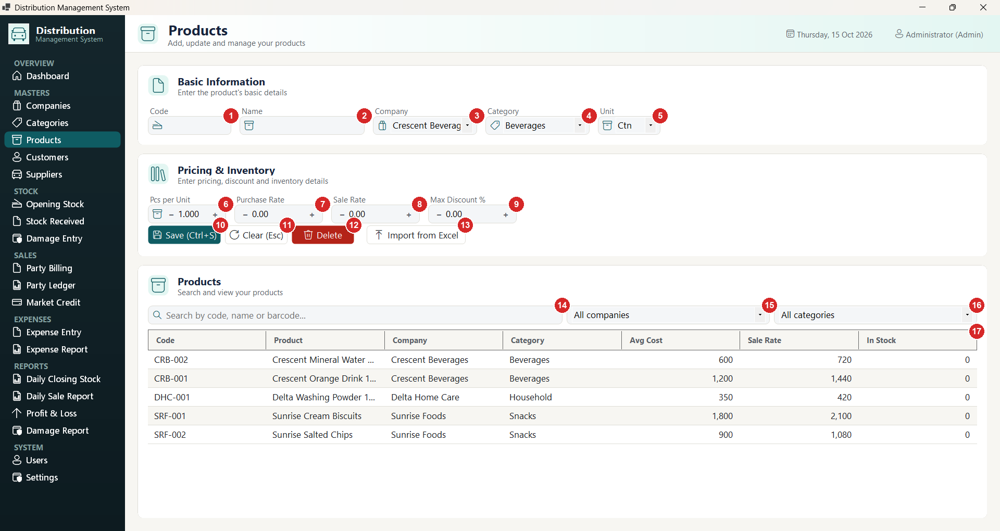

**Figure 25a: Products screen (numbered).** Unmarked original: [Figure 25](assets/screenshots/25-products-list.png).

| No. | Control | Purpose and effect |
|---|---|---|
| 1 | **Code** | Unique product code, for example `SRF-001`. |
| 2 | **Name** | Product name as you want it to appear on bills and reports. |
| 3 | **Company** | Drop-down list of companies. Choose the manufacturer or brand. |
| 4 | **Category** | Drop-down list of categories. |
| 5 | **Unit** | How the product is counted: **Ctn** (carton), **Box**, **Pcs** (pieces) or **Bag**. |
| 6 | **Pcs per Unit** | How many pieces are in one unit, for example 24 biscuit packets in one carton. Kept for information only. |
| 7 | **Purchase Rate** | The usual price you pay per unit. |
| 8 | **Sale Rate** | The usual price you sell at per unit. This is filled in automatically on Party Billing. |
| 9 | **Max Discount %** | The highest line discount an Operator or Viewer may give on this product. |
| 10 | **Save (Ctrl+S)** / **Update (Ctrl+S)** | Saves a new product or your changes. |
| 11 | **Clear (Esc)** | Empties the form (Pcs per Unit goes back to 1) and leaves edit mode. |
| 12 | **Delete** | Deletes the product loaded in the form. |
| 13 | **Import from Excel** | Adds or updates many products from an Excel file. See [Import from Excel](#import-from-excel). |
| 14 | Search box | Filters by code, name or barcode. |
| 15 | **All companies** filter | Shows only products of the chosen company. |
| 16 | **All categories** filter | Shows only products of the chosen category. |
| 17 | **Products** list | Click a row to edit the product. |

### Form: Basic Information and Pricing & Inventory

| Field Name | Purpose | Required/Optional | How to Enter the Value | Validation/Restrictions |
|---|---|---|---|---|
| Code | Unique product code | **Required** | Type, for example `SRF-001` | Up to 30 characters. Must not repeat any existing or deleted product code; a repeat shows a technical error like Figure 13. |
| Name | Product name | **Required** | Type, for example `Sunrise Cream Biscuits` | Up to 200 characters. |
| Company | Manufacturer or brand | **Required** | Choose from the list | Lists companies that existed when the screen was first opened in this session. The first company is selected automatically. |
| Category | Product group | **Required** | Choose from the list | Same as Company. |
| Unit | Counting unit | **Required** | Choose **Ctn**, **Box**, **Pcs** or **Bag** | Default **Ctn**. |
| Pcs per Unit | Pieces in one unit | Optional | Type a number or use **−**/**+** | 0 to 99,999, up to 3 decimals. Shows 0.00 the first time the screen opens and 1.000 after **Clear**. |
| Purchase Rate | Normal buying price (Rs) | Optional | Number | 0 to 9,999,999, 2 decimals. Used as the starting **Avg Cost** when a new product is saved. |
| Sale Rate | Normal selling price (Rs) | Optional | Number | 0 to 9,999,999, 2 decimals. A bill line needs a rate above 0, so set a real sale rate. |
| Max Discount % | Discount limit for non-Admin users | Optional | Number | 0 to 100. With 0, Operators and Viewers cannot give any line discount on this product. |

> **Barcode:** the Products search can find products by barcode, but barcodes can only be added through **Import from Excel**. The form has no barcode field, and saving the form does not change an existing barcode.

### List columns

| Column | Meaning |
|---|---|
| Code, Product, Company, Category | As entered. |
| Avg Cost | The weighted average cost of the stock you hold. It starts at the Purchase Rate and is recalculated automatically each time you record Opening Stock or Stock Received. Changing **Purchase Rate** later does **not** change Avg Cost. |
| Sale Rate | Current sale rate. |
| In Stock | Current quantity = all stock in (opening stock and purchases) minus all stock out (sales and damage). Shown as a whole number. **May be out of date** until you refresh (Figures 54 and 55). |

### Screen states

| Figure | State |
|---|---|
| 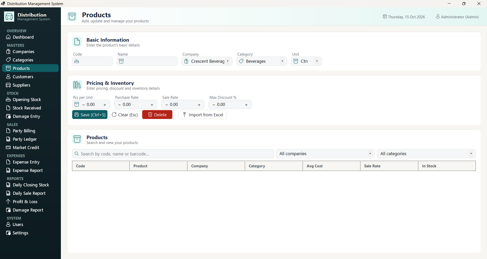 **Figure 21** | No products yet. |
| 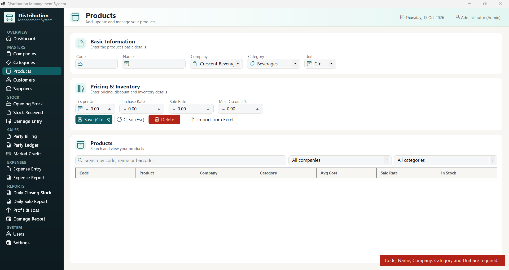 **Figure 22** | **"Code, Name, Company, Category and Unit are required."** |
| 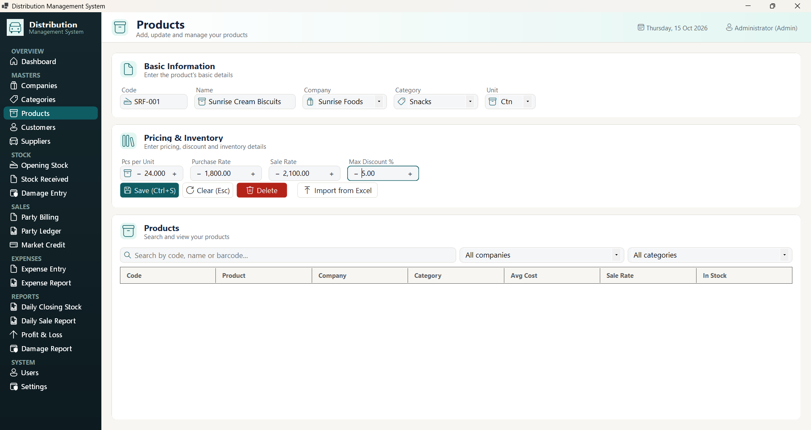 **Figure 23** | Form filled with example data. |
| 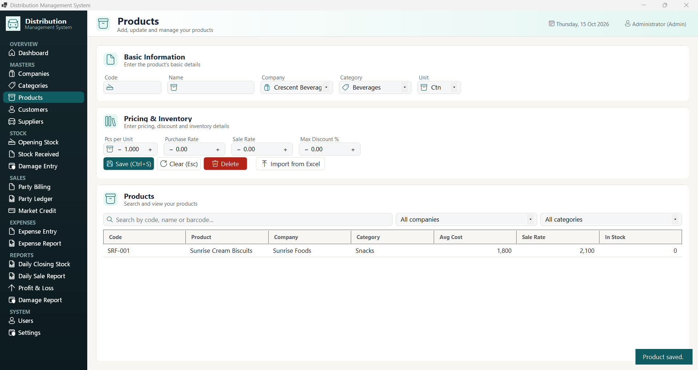 **Figure 24** | **"Product saved."** and the product appears in the list. |
| 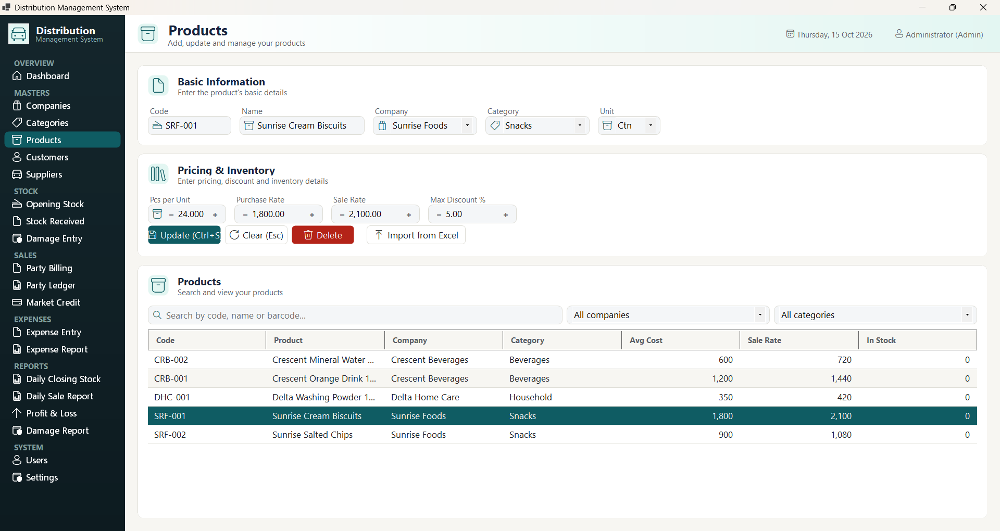 **Figure 26** | A product loaded for editing. |
| 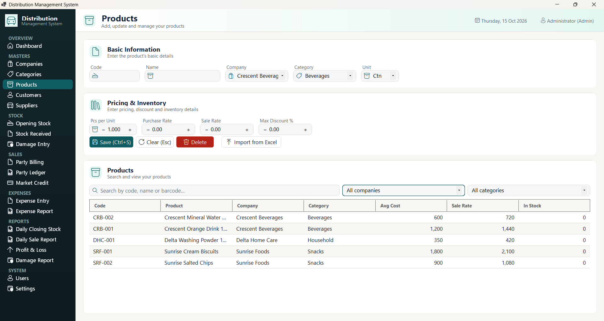 **Figure 27** | The company filter opened. |
| 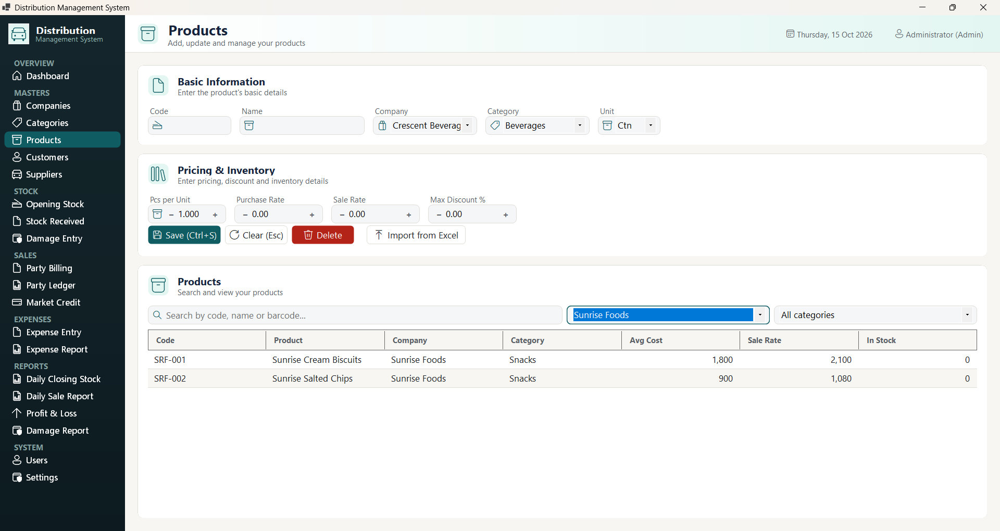 **Figure 28** | Only *Sunrise Foods* products shown. To remove the filter, choose **All companies** again. |
| 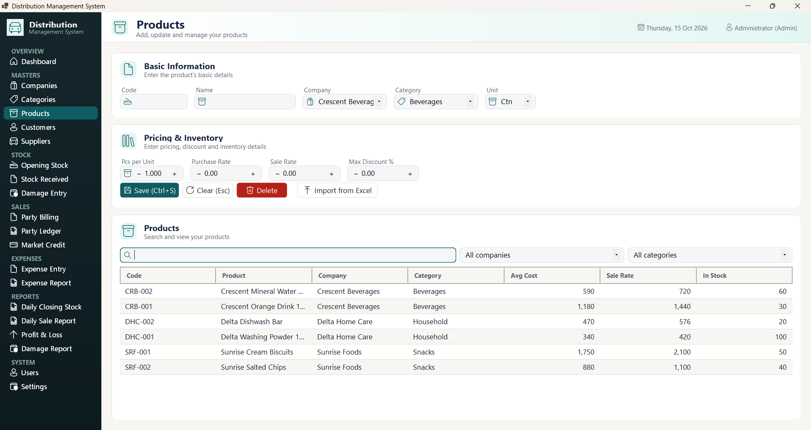 **Figure 55** | **In Stock** and **Avg Cost** after stock was recorded. The screen reloads these figures each time you open it. |

### Messages

"Product saved.", "Product updated.", "Delete this product?" (**Yes**/**No**), "Product deleted."

### Effects of actions

| Action | Effect |
|---|---|
| Save product | Appears in the Products list and in the product drop-downs on Opening Stock, Stock Received, Damage Entry and Party Billing the next time you open those screens. Appears in Daily Closing Stock. |
| Change Sale Rate | Party Billing fills in the new rate the next time you open it. Bills already saved keep their original rates. |
| Change Max Discount % | Takes effect on the next bill saved. |
| Delete product | Removed from the Products list, from the product drop-downs and from Daily Closing Stock. **The application allows this even if the product still has stock.** Past bills, purchases and damage entries keep their records. A deleted product cannot be restored from the application. |

> **Caution:** Deleting a product that still has stock makes that stock disappear from the stock reports. Check **In Stock** first.

### Import from Excel

Use this to create many products at once, or to update prices of existing products.

**Prepare the Excel file (.xlsx):**

- The application reads the **first worksheet** only.
- **Row 1** must contain column headings. Upper or lower case does not matter, but the spelling must be exact.
- Each following row is one product. Empty rows are skipped.

| Heading | Required | What to put | Rule |
|---|---|---|---|
| Code | Yes | Product code | If a product with this code already exists, it is **updated**. Otherwise a new product is created. |
| Name | Yes | Product name | Must not be blank. |
| Company | Yes | Company **name** (not code) | Must exactly match an existing company name (upper/lower case ignored). |
| Category | Yes | Category name | Must match an existing category. |
| Unit | Yes | Ctn, Box, Pcs or Bag | Any other value is rejected. |
| PcsPerUnit | Yes | Number | Must be numeric. |
| PurchaseRate | Yes | Number | Must be numeric. |
| SaleRate | Yes | Number | Must be numeric. |
| MaxDiscountPct | No | Number | If the column is missing or the cell is not a number, 0 is used. |
| Barcode | No | Text | If the column is missing or the cell is blank, the product's barcode is **removed**. |

**Run the import:**

1. Close the Excel file (an open file may not be readable).
2. On the Products screen, click **Import from Excel**.
3. In the **Import Products** window (Figure 29), find and select your file, then click **Open**.
4. Read the result:
   - If every row was accepted, a green message such as **"Imported: 3, Updated: 1, Errors: 0"** appears.
   - If some rows were rejected, a window titled **"Imported: X, Updated: Y, Errors: Z"** lists up to 20 problems with their row numbers (Figure 30). Click **OK**. Rows without errors **were still saved**.
5. The Products list reloads automatically (Figure 31).

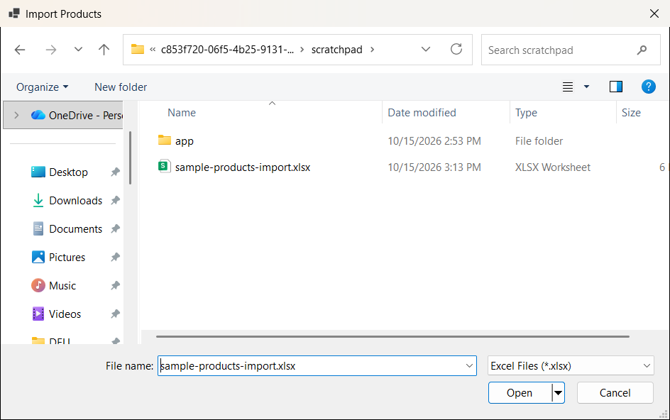

**Figure 29: Choosing the Excel file**

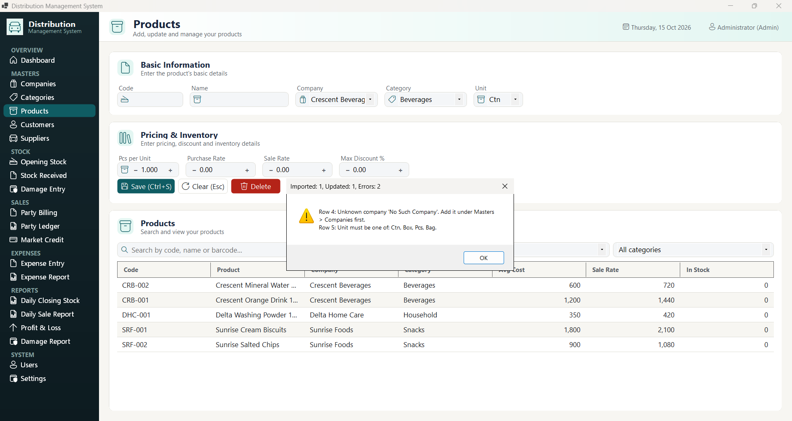

**Figure 30: Import result. One product was imported, one was updated and two rows had errors: "Row 4: Unknown company 'No Such Company'. Add it under Masters > Companies first." and "Row 5: Unit must be one of: Ctn, Box, Pcs, Bag."**

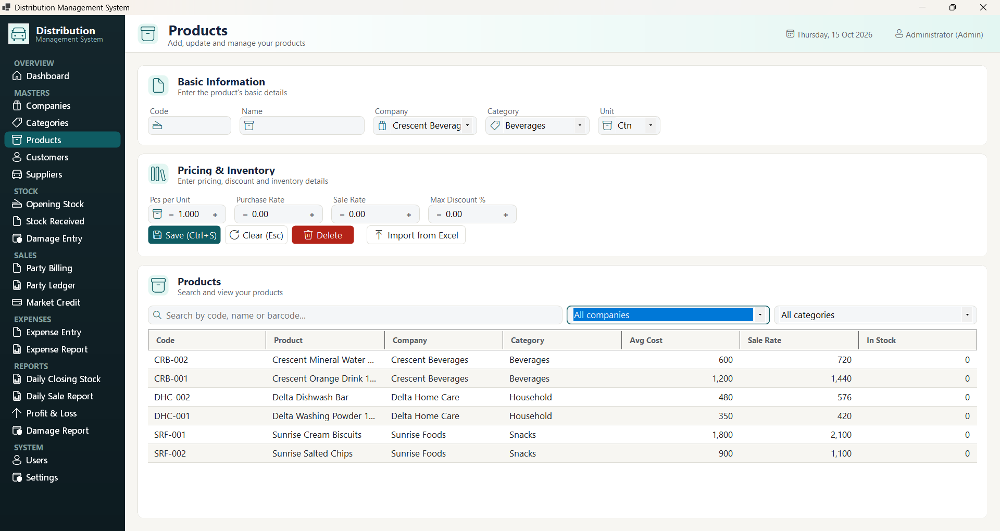

**Figure 31: Products list after the import. DHC-002 was added and SRF-002's sale rate was updated.**

**Import messages:**

| Message | Meaning |
|---|---|
| Row 1: Missing required column(s): … | A required heading is missing or misspelled in row 1. Nothing was imported. |
| Row N: Code and Name are required. | Code or Name is blank in that row. |
| Row N: Unknown company '…'. Add it under Masters > Companies first. | Company name not found. |
| Row N: Unknown category '…'. Add it under Masters > Categories first. | Category name not found. |
| Row N: Unit must be one of: Ctn, Box, Pcs, Bag. | Invalid unit. |
| Row N: PcsPerUnit, PurchaseRate and SaleRate must be numeric. | One of these cells is not a number. |
| Import failed: … | The whole file could not be read, for example because it is open in Excel, is not a real .xlsx file, or is damaged. |

> **Caution:** Updating an existing product through import overwrites **all** of its listed values, including Max Discount % (set to 0 if the column is missing) and Barcode (removed if the column is missing or blank).

---

## 7. Customers

### Overview

| | |
|---|---|
| **Screen title** | Customers — *Manage your customer accounts* |
| **Purpose** | Keeps the shops and parties you sell to, their area or route, and their starting balance. |
| **Before you start** | At least one Area / Route is needed. You can add one directly from this screen. |

### How to open it

Click **Customers** under **MASTERS**.

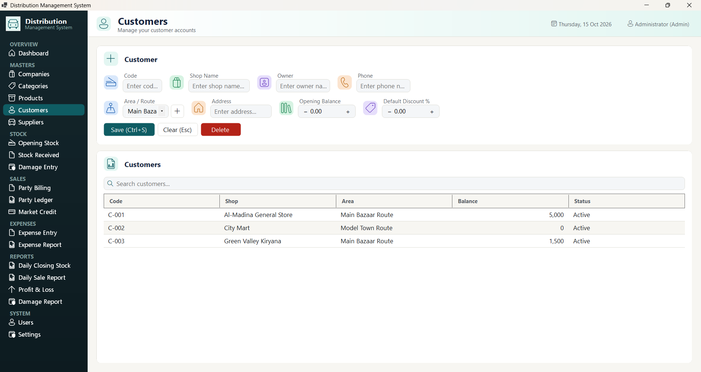

**Figure 40: Customers screen with three customers**

### Controls

| Control | Purpose and effect |
|---|---|
| **Code** | Unique customer code, for example `C-001`. |
| **Shop Name** | The shop or party name. Appears on bills and reports. |
| **Owner** | Owner's name (optional). |
| **Phone** | Phone number (optional). |
| **Area / Route** | Drop-down of delivery areas or routes. |
| **+** button (next to Area / Route) | Opens the **New Area** window to add an area or route (Figure 35). |
| **Address** | Shop address (optional). |
| **Opening Balance** | The amount the customer already owed you when you started using the application. |
| **Default Discount %** | A discount percentage stored with the customer for your reference. **It is not applied automatically on bills**; enter discounts on each bill line. |
| **Save (Ctrl+S)** / **Update (Ctrl+S)**, **Clear (Esc)**, **Delete** | Same as on Companies. |
| Search box (**Search customers...**) | Filters by shop name or code. |
| **Customers** list | Columns **Code**, **Shop**, **Area**, **Balance**, **Status**. |

### Form: Customer

| Field Name | Purpose | Required/Optional | How to Enter the Value | Validation/Restrictions |
|---|---|---|---|---|
| Code | Unique code | **Required** | Type, for example `C-001` | Up to 30 characters. Must be unique, including deleted customers. |
| Shop Name | Customer name | **Required** | Type | Up to 200 characters. |
| Owner | Owner's name | Optional | Type | Up to 200 characters. |
| Phone | Phone | Optional | Type | Up to 50 characters. No format check. |
| Area / Route | Delivery area | **Required** | Choose from the list, or click **+** to add a new one | The list is empty until at least one area is added. |
| Address | Address | Optional | Type | Up to 500 characters. |
| Opening Balance | Amount owed at start (Rs) | Optional | Number | 0 to 999,999,999. Cannot be negative, so an advance paid by a customer cannot be entered here. |
| Default Discount % | Reference discount | Optional | Number | 0 to 100. Stored only. |

### Adding an Area / Route

1. Click the **+** button next to **Area / Route**.
2. The **New Area** window opens with the label **"Area / route name:"** (Figure 35).
3. Type the name, for example `Main Bazaar Route`.
4. Click **OK** or press **Enter**. Click **Cancel** (or press **Esc**) to close without adding.
5. The green message **"Area added."** appears (Figure 36), and the new area is available in the drop-down.

> Areas cannot be renamed or deleted in this version, and the same name can be added twice. Check the drop-down before adding.

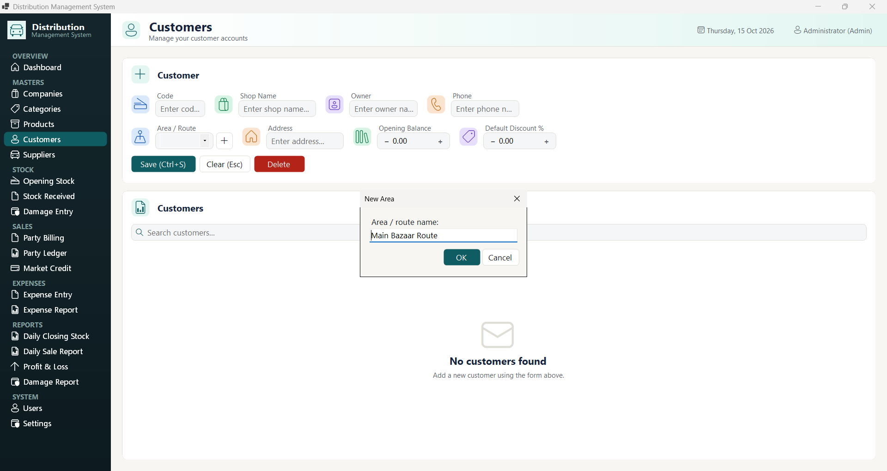

**Figure 35: New Area window**

### List columns

| Column | Meaning |
|---|---|
| Code, Shop, Area | As entered. |
| Balance | What the customer owes now = Opening Balance + all bills − all cash received on bills. |
| Status | Always **Active** in this version. |

### Screen states

| Figure | State |
|---|---|
| 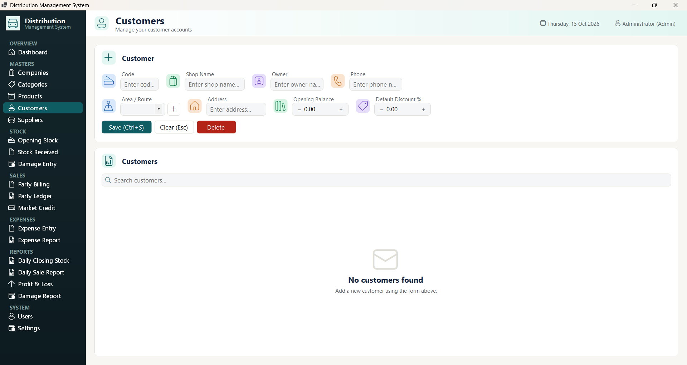 **Figure 34** | No customers yet: **"No customers found — Add a new customer using the form above."** |
| 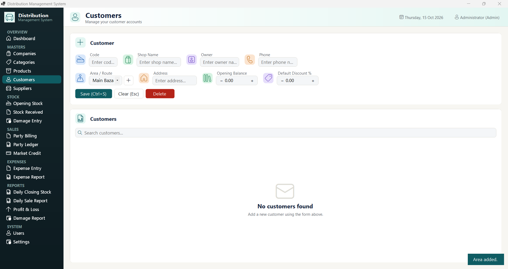 **Figure 36** | **"Area added."** |
| 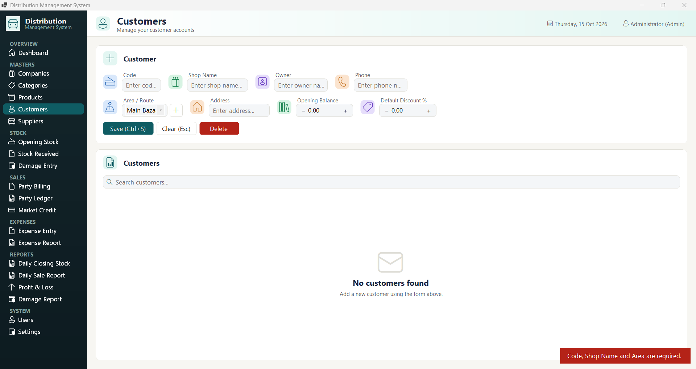 **Figure 37** | **"Code, Shop Name and Area are required."** |
| 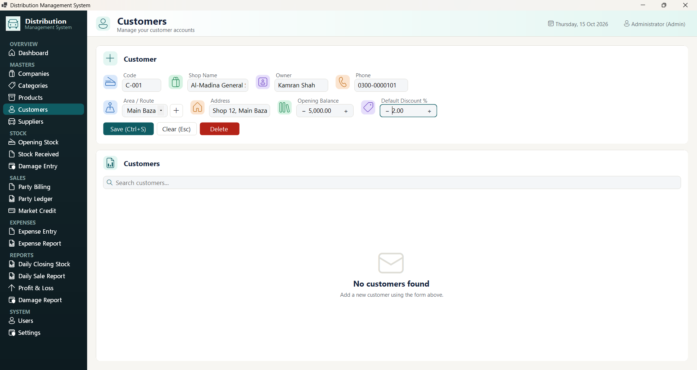 **Figure 38** | Form filled with example data. |
| 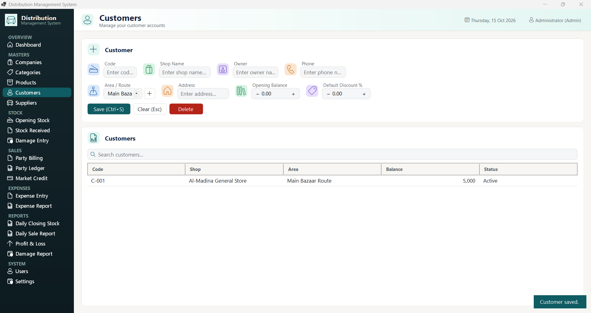 **Figure 39** | **"Customer saved."** |
| 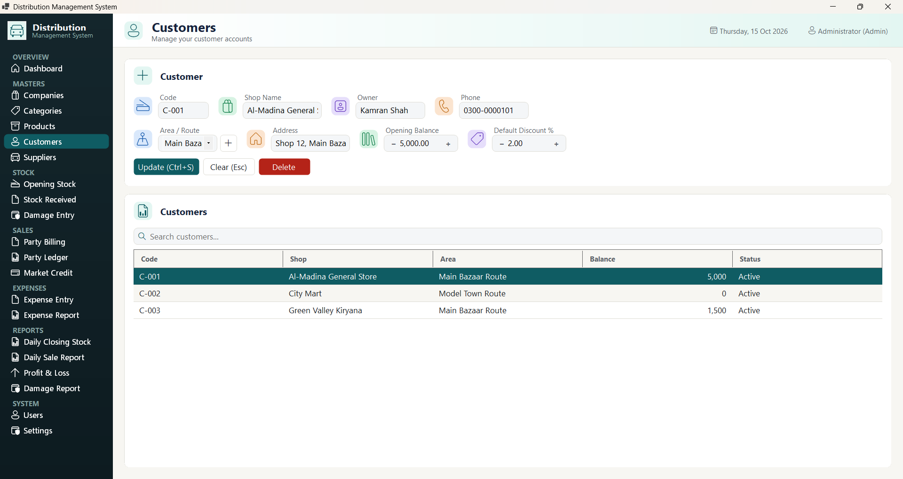 **Figure 41** | A customer loaded for editing. |
| 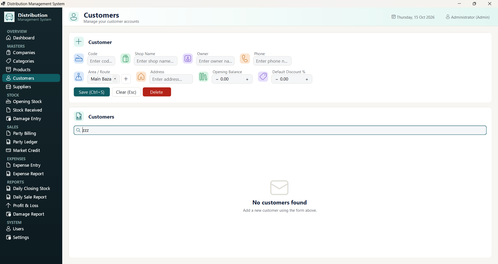 **Figure 42** | A search that matches nothing shows the "No customers found" message. Clear the search box to see all customers again. |

### Messages

"Customer saved.", "Customer updated.", "Delete this customer?" (**Yes**/**No**), "Customer deleted.", "Area added."

### Effects of actions

| Action | Effect |
|---|---|
| Save customer | Available in the **Customer** drop-downs on Party Billing, Receive Payment and Party Ledger the next time you open those screens. Appears on Market Credit when the balance is above zero. |
| Change Opening Balance | Changes the customer's **Balance**, Party Billing's **Previous Balance**, the Party Ledger opening row and Market Credit. |
| Delete customer | Removed from all customer lists and from Market Credit, **even if the customer still owes money**. There is no check for an outstanding balance. Past bills remain in the reports. |

> **Caution:** Check the **Balance** column before deleting a customer. Once deleted, the customer cannot be restored and their dues no longer appear on Market Credit.

---

## 8. Suppliers

### Overview

| | |
|---|---|
| **Screen title** | Suppliers — *Manage your supplier records easily* |
| **Purpose** | Keeps the parties you buy stock from. |
| **Before you start** | At least one company must exist. |

### How to open it

Click **Suppliers** under **MASTERS**.

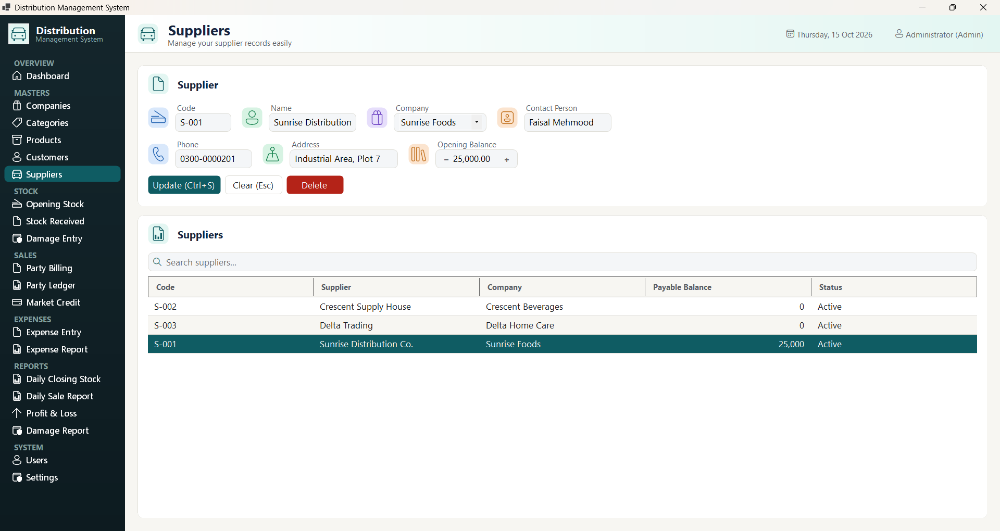

**Figure 48: Suppliers screen with a supplier loaded for editing**

### Form: Supplier

| Field Name | Purpose | Required/Optional | How to Enter the Value | Validation/Restrictions |
|---|---|---|---|---|
| Code | Unique code | **Required** | Type, for example `S-001` | Up to 30 characters. Unique, including deleted suppliers. |
| Name | Supplier name | **Required** | Type | Up to 200 characters. |
| Company | Which company's goods this supplier provides | **Required** | Choose from the list | Lists companies that existed when the screen was first opened. |
| Contact Person | Contact | Optional | Type | Up to 200 characters. |
| Phone | Phone | Optional | Type | Up to 50 characters. |
| Address | Address | Optional | Type | Up to 500 characters. |
| Opening Balance | Amount you owed this supplier when you started | Optional | Number | 0 to 999,999,999. |

Buttons, search and row selection work exactly as on [Companies](#4-companies). The search box (**Search suppliers...**) searches by name or code.

### List columns

| Column | Meaning |
|---|---|
| Code, Supplier, Company | As entered. |
| Payable Balance | **Shows only the Opening Balance.** Purchases recorded on Stock Received do **not** change this figure, and there is no supplier payment screen in this version. Keep supplier accounts separately. |
| Status | Always **Active**. |

### Screen states

| Figure | State |
|---|---|
| 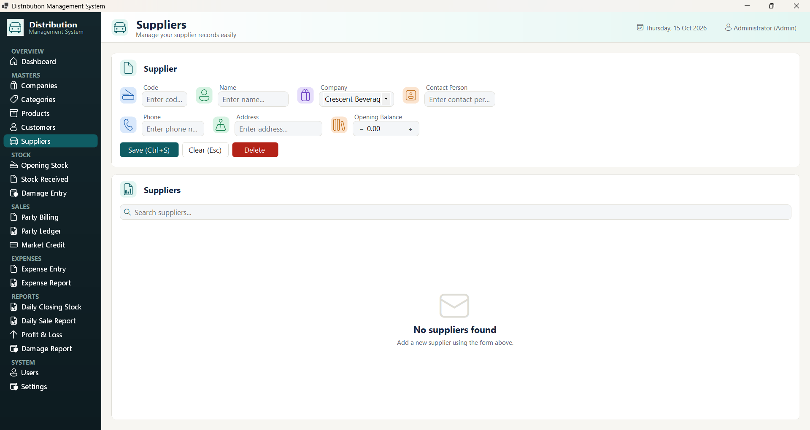 **Figure 43** | No suppliers: **"No suppliers found — Add a new supplier using the form above."** |
| 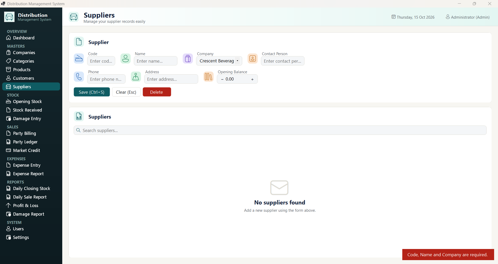 **Figure 44** | **"Code, Name and Company are required."** |
| 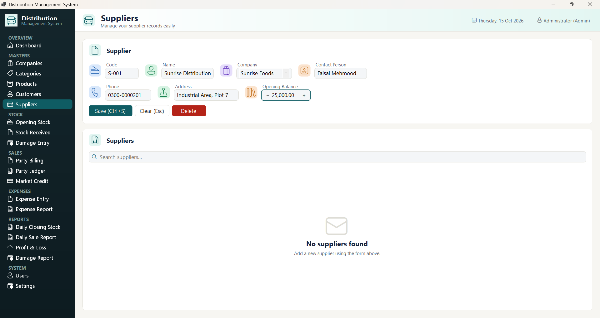 **Figure 45** | Form filled. |
| 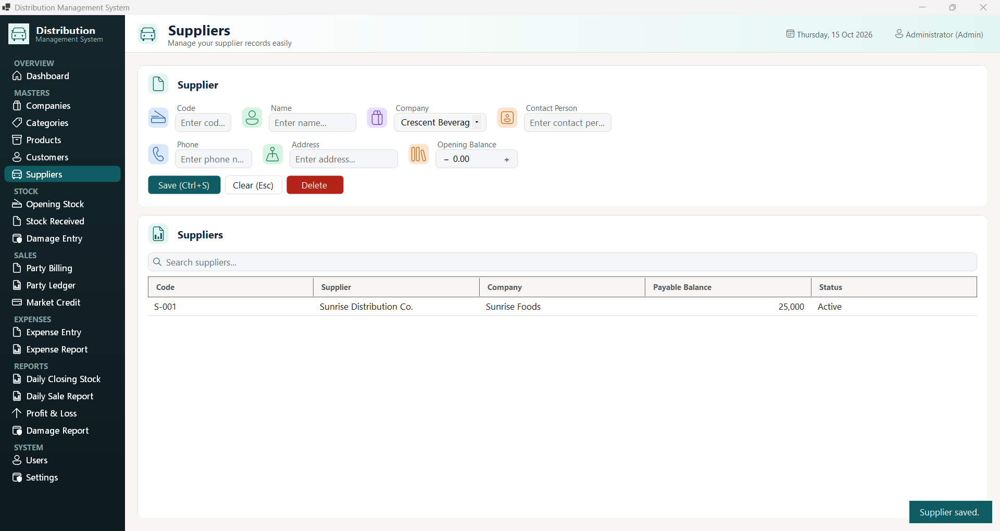 **Figure 46** | **"Supplier saved."** |
|  **Figure 47** | Three suppliers. |

### Messages

"Supplier saved.", "Supplier updated.", "Delete this supplier?" (**Yes**/**No**), "Supplier deleted."

### Effects

- New suppliers appear in the **Supplier** drop-down the next time you open Stock Received.
- A company cannot be deleted while it has suppliers.
- A deleted supplier disappears from lists. Past purchases keep the supplier's name.

---

## 9. Opening Stock

### Overview

| | |
|---|---|
| **Screen title** | Opening Stock — *One-time setup of starting stock* |
| **Purpose** | Records the quantity and cost of each product you already hold when you start using the application. |
| **Who uses it** | Usually the administrator, once, during setup. |

### How to open it

Click **Opening Stock** under **STOCK**.

**Figure 53: Opening Stock with six entries recorded**

### Form: Opening Stock

| Field Name | Purpose | Required/Optional | How to Enter the Value | Validation/Restrictions |
|---|---|---|---|---|
| As On Date | The date the stock was counted | Required (pre-filled with today) | Click the date and use the calendar, or type the date | Stock dated before a report date counts as **Opening** on Daily Closing Stock. Stock dated on the report date counts as **Received**. |
| Product | The product counted | **Required** | Choose from the list (shown as `CODE - Name`) | The first product is selected automatically. |
| Qty | Quantity held | **Required** | Number | Must be greater than 0. Up to 3 decimals. |
| Cost Rate | Cost per unit (Rs) | Optional | Number | 2 decimals. If you leave it at 0, the product's average cost is pulled down (see below). |

### Buttons and list

| Control | Effect |
|---|---|
| **Save (Ctrl+S)** | Records the stock. Shows **"Opening stock saved."**, then clears **Qty** and **Cost Rate**. **As On Date** and **Product** stay as they were, so you can quickly enter the next product. |
| **Recent Opening Stock Entries** | The last 50 opening stock entries, newest first: **Date**, **Code**, **Product**, **Qty**, **Cost Rate**, **Value** (Qty × Cost Rate). |

### Screen states

| Figure | State |
|---|---|
|  **Figure 49** | Nothing recorded: **"No opening stock recorded yet"**. |
|  **Figure 50** | **"Quantity must be greater than zero."** |
|  **Figure 51** | Form filled (As On Date set to an earlier date). |
|  **Figure 52** | **"Opening stock saved."** |

Other message: **"Select a product."** (no product chosen, for example when no products exist).

### Effects

| Effect | Where to verify |
|---|---|
| The product's stock increases by Qty. | Products → **In Stock**; Daily Closing Stock. |
| The product's **Avg Cost** is recalculated. If the product had no stock, Avg Cost becomes the Cost Rate. Otherwise it becomes the weighted average of old and new stock. | Products → **Avg Cost**. |

> **Warning — this screen does not stop repeats.** Despite the words "one-time", the application accepts several entries for the same product, and each one **adds** more stock. Entries cannot be edited or deleted from the application. Check the **Recent Opening Stock Entries** list before saving.

---

## 10. Stock Received

### Overview

| | |
|---|---|
| **Screen title** | Stock Received — *Receive stock from your suppliers* |
| **Purpose** | Records a delivery (purchase invoice) from a supplier and adds the goods to stock. |
| **Before you start** | Suppliers and products must exist. |

### How to open it

Click **Stock Received** under **STOCK**.

**Figure 60a: Stock Received with two item lines ready to save (numbered).** Unmarked original: [Figure 60](assets/screenshots/60-stock-received-ready.png).

| No. | Control | Purpose and effect |
|---|---|---|
| 1 | **Supplier** | Choose the supplier (shown as `CODE - Name`). |
| 2 | **Invoice No** | The supplier's invoice or bill number. |
| 3 | **Date** | Date of receipt (pre-filled with today). |
| 4 | **Vehicle No** | Vehicle that delivered the goods (optional). |
| 5 | **Bilti Charges** | Freight or transport charges paid for this delivery (optional). |
| 6 | **Product** | Product for the line you are adding. |
| 7 | **Qty** | Quantity received. |
| 8 | **Rate** | Purchase price per unit on this invoice. |
| 9 | **Add Line** | Adds the product, Qty and Rate to the item list below, then clears Qty and Rate. |
| 10 | Item list | Lines added so far: **Code**, **Product**, **Qty**, **Rate**, **Amount** (Qty × Rate). |
| 11 | **Total: Rs …** | Sum of all line amounts. Bilti is not included. |
| 12 | **Save Purchase (Ctrl+S)** | Saves the whole delivery and updates stock. |
| 13 | **Clear (Esc)** | Clears Invoice No, Vehicle No, Bilti Charges and **all item lines**. Supplier and Date stay. |
| 14 | **Today's Purchases** | Purchases dated today: **Invoice No**, **Date**, **Supplier**, **Total Amount**, **Bilti**. |

### Form fields

| Field Name | Purpose | Required/Optional | How to Enter the Value | Validation/Restrictions |
|---|---|---|---|---|
| Supplier | Who delivered | **Required** | Choose from the list | Lists suppliers that existed when the screen was first opened. |
| Invoice No | Supplier's invoice number | **Required** | Type, for example `INV-SF-1001` | Up to 50 characters. **Repeated invoice numbers are not blocked**, so check Today's Purchases to avoid saving the same delivery twice. |
| Date | Receipt date | Required (pre-filled) | Calendar or type | — |
| Vehicle No | Vehicle | Optional | Type | Up to 50 characters. |
| Bilti Charges | Freight paid (Rs) | Optional | Number | 0 or more. If above 0, an expense is created automatically (see Effects). |
| Product (line) | Item | **Required for each line** | Choose | — |
| Qty (line) | Quantity | **Required** | Number | Must be greater than 0. Up to 3 decimals. |
| Rate (line) | Price per unit | **Required** | Number | Must be greater than 0. |

### Screen states

| Figure | State |
|---|---|
|  **Figure 56** | Empty screen: **"No purchases received today"**. |
|  **Figure 57** | **Add Line** with Qty or Rate at 0: **"Qty and Rate must be greater than zero."** |
|  **Figure 58** | **Save Purchase** without an invoice number: **"Supplier and Invoice No are required."** |
|  **Figure 59** | Second line being entered. |
|  **Figure 61** | **"Purchase saved and stock updated."** The form clears and the purchase appears in **Today's Purchases**. |
|  **Figure 62** | Two purchases listed for today. |

Other messages: **"Select a product."**, **"Add at least one item line."**

### Effects of saving a purchase

| Effect | Where to verify |
|---|---|
| Each product's stock increases by the line Qty. | Products → **In Stock**, Daily Closing Stock → **Received**. |
| Each product's **Avg Cost** is recalculated as a weighted average of old stock and new stock at the line Rate. | Products **Avg Cost**, Daily Closing Stock **Avg Cost**. |
| If **Bilti Charges** is above 0, a business expense is created automatically: voucher **BILTI-n**, category **Bilti / Freight**, paid from **Cash**, description "Bilti/freight for purchase *invoice no*". | Expense Entry → Today's Expenses (Figure 84); Expense Report; Profit & Loss → Business Expenses. |
| The supplier's **Payable Balance** is **not** changed. | — |

> **No corrections after saving.** A saved purchase cannot be edited or deleted from the application. **Before saving**, there is no way to remove a single line: click **Clear (Esc)** and add the lines again (the invoice number and bilti are cleared too).

---

## 11. Damage Entry

### Overview

| | |
|---|---|
| **Screen title** | Damage Entry — *Record damaged or lost stock* |
| **Purpose** | Removes broken, expired or lost goods from stock and records the loss. |

### How to open it

Click **Damage Entry** under **STOCK**.

**Figure 68: Damage Entry with two entries in the Damage Register**

### Form fields

| Field Name | Purpose | Required/Optional | How to Enter the Value | Validation/Restrictions |
|---|---|---|---|---|
| Date | When the damage was found | Required (pre-filled with today) | Calendar or type | — |
| Product | Damaged product | **Required** | Choose | — |
| Qty | Quantity damaged | **Required** | Number | Greater than 0 and **not more than the current stock** of the product. |
| Reason | Cause | **Required** | Choose, or click **+** to add a reason | The list is empty until you add the first reason. |
| Found At | Where the damage was found | **Required** | Choose **Godown**, **In Transit** or **Returned by Party** | — |
| Remarks | Notes | Optional | Type | Up to 500 characters. |

**+ (next to Reason):** opens the **New Damage Reason** window, with the label **"Reason name:"** (Figure 64). Type a reason, for example `Expired`, and click **OK**. The message **"Reason added."** appears.

**Save (Ctrl+S):** records the damage. On success: **"Damage entry saved."**, then Qty and Remarks are cleared.

**Damage Register:** the last 100 damage entries, newest first. Columns: **Ref No** (automatic, for example DMG-00001), **Date**, **Product**, **Qty**, **Reason**, **Found At**, **Loss Amount**.

### Screen states

| Figure | State |
|---|---|
|  **Figure 63** | **"No damage entries recorded"**. |
|  **Figure 64** | New Damage Reason window. |
|  **Figure 65** | Qty larger than stock: **"Insufficient stock for 'Delta Dishwash Bar'. Available: 20.000, requested: 999.000."** |
|  **Figure 66** | Form filled. |
|  **Figure 67** | **"Damage entry saved."** |

Other messages: **"Product, Reason and Found At are required."**, **"Quantity must be greater than zero."**

### Effects

| Effect | Where to verify |
|---|---|
| Stock of the product decreases by Qty. | Products **In Stock**, Daily Closing Stock **Damage** column. |
| **Loss Amount** = Qty × the product's current Avg Cost. Example: 2 cartons × Rs 1,764.29 = Rs 3,529. | Damage Register; Damage Report; Profit & Loss → **Damage Loss**. |
| A reference number DMG-nnnnn is assigned. | Damage Register. |

> Damage entries cannot be edited or deleted. The stock check uses today's total stock, whatever date you choose.

---

## 12. Party Billing

### Overview

| | |
|---|---|
| **Screen title** | Party Billing — *Create a new sale bill* |
| **Purpose** | Creates a sale bill for a customer, records any cash received, and reduces stock. |
| **Before you start** | Customers and products with stock must exist. |

### How to open it

Click **Party Billing** under **SALES**, or click **New Bill (F2)** on the Dashboard.

**Figure 72a: Party Billing with a bill ready to save (numbered).** Unmarked original: [Figure 72](assets/screenshots/72-party-billing-ready.png).

| No. | Control | Purpose and effect |
|---|---|---|
| 1 | **Customer** | Choose the customer (shown as `CODE - Shop Name`). |
| 2 | **Date** | Bill date (pre-filled with today). |
| 3 | **Previous Balance: Rs …** | What the selected customer owes **before** this bill. It updates when you change the customer. |
| 4 | **Product** | Choose a product. Its **Sale Rate** is filled into **Rate** automatically. |
| 5 | **Qty** | Quantity sold. |
| 6 | **Rate** | Price per unit. You can change it for this bill. |
| 7 | **Discount %** | Line discount as a percentage of the line amount. |
| 8 | **Add Line** | Adds the line to the bill, then clears Qty and Discount %. |
| 9 | Item list | **Code**, **Product**, **Qty**, **Rate**, **Disc %**, **Net Amount** (amount after line discount). |
| 10 | **Bill Discount** | An extra discount for the whole bill, **in rupees** (not percent). |
| 11 | **Cash Received** | Money collected from the customer now, in rupees. Whatever you do **not** enter here is added to the customer's balance as credit. |
| 11a | **Received In** | Whether that money came as **Cash** or **Bank**. Shown on the receipt in the ledger and on Receive Payment. |
| 12 | **Net Bill / New Balance** | Live totals. **Net Bill** = sum of line net amounts − Bill Discount. **New Balance** = Previous Balance + Net Bill − Cash Received. |
| 13 | **Save Bill (Ctrl+S)** | Saves the bill. |
| 14 | **Clear (Esc)** | Removes all lines and resets Bill Discount and Cash Received to 0. Customer and Date stay. |

Below these is **Today's Bills** (scroll down): **Bill No**, **Customer**, **Net Amount**, **Cash Received** for bills dated today (Figure 75).

### Form fields

| Field Name | Purpose | Required/Optional | How to Enter the Value | Validation/Restrictions |
|---|---|---|---|---|
| Customer | Buyer | **Required** | Choose | The first customer is selected automatically. The list is refreshed after each saved bill. |
| Date | Bill date | Required (pre-filled) | Calendar or type | — |
| Product (line) | Item sold | **Required** | Choose | Lists products as they were when the screen was first opened in this session. |
| Qty (line) | Quantity | **Required** | Number | Greater than 0. Up to 3 decimals. Cannot be more than the stock available (checked on save). |
| Rate (line) | Price | **Required** | Auto-filled; may be edited | Greater than 0. |
| Discount % (line) | Line discount | Optional | Number | 0 to 100. Operators and Viewers cannot exceed the product's **Max Discount %** (checked on save). Admins can. |
| Bill Discount | Whole-bill discount (Rs) | Optional | Number | 0 or more. |
| Cash Received | Payment now (Rs) | Optional | Number | 0 or more. May be more or less than the bill. Anything not paid now stays on the customer's account as credit. |
| Received In | Cash or bank | Required (pre-selected) | Choose **Cash** or **Bank** | Default **Cash**. Only matters when Cash Received is above 0. |

### How amounts are calculated

For each line:

- **Amount** = Qty × Rate, rounded to the nearest rupee.
- **Line discount** = Amount × Discount % ÷ 100, rounded to the nearest rupee.
- **Net Amount** = Amount − line discount.

For the bill:

- **Net Bill** = total of line Net Amounts − Bill Discount.
- **New Balance** = Previous Balance + Net Bill − Cash Received.

**Worked example (Figure 72):** Customer *Al-Madina General Store* has a Previous Balance of Rs 10,950.

| Line | Qty × Rate | Amount | Discount | Net |
|---|---|---|---|---|
| Sunrise Cream Biscuits | 5 × 2,100 | 10,500 | 2% = 210 | 10,290 |
| Crescent Orange Drink 1.5L | 4 × 1,440 | 5,760 | 0 | 5,760 |
| | | | **Lines total** | **16,050** |

Net Bill = 16,050 − Bill Discount 100 = **Rs 15,950**. New Balance = 10,950 + 15,950 − Cash Received 10,000 = **Rs 16,900**.

Of this bill, Rs 10,000 was paid now and **Rs 5,950 went on credit**. The message after saving states this amount.

### Screen states

| Figure | State |
|---|---|
|  **Figure 69** | New bill screen. Previous Balance of the first customer is shown. |
|  **Figure 70** | **Save Bill** with no lines: **"Add at least one item."** |
|  **Figure 71** | Product chosen: Rate filled with the Sale Rate (2,100). |
|  **Figure 73** | After saving, the message states the bill number and how much went on credit, for example **"Bill BILL-00004 saved. Rs 5,950 on credit — new balance Rs 16,900."** A fully paid bill shows **"… saved. Fully paid."** instead. The lines clear. |
|  **Figure 74** | Qty larger than stock: **"Insufficient stock for 'Delta Dishwash Bar'. Available: 20.000, requested: 500.000."** The bill is **not** saved and the lines stay so you can correct them. |
|  **Figure 75** | Today's Bills after three bills. |
|  **Figure 106** | Signed in as an **Operator**, a 10% discount on a product with Max Discount 5%: **"Discount 10.00% exceeds max allowed 5.00% for Sunrise Cream Biscuits."** |

Other messages: **"Select a customer."**, **"Select a product."**, **"Qty and Rate must be greater than zero."**

### Effects of saving a bill

| Effect | Where to verify |
|---|---|
| A bill number is assigned automatically: BILL-00001, BILL-00002, … | Success message; Today's Bills; Daily Sale Report; Party Ledger. |
| Stock of every product on the bill decreases. | Products → **In Stock**; Daily Closing Stock → **Sold**. |
| The customer's balance increases by Net Bill. | Customers → **Balance**; Party Ledger (**Sale**, Debit); Market Credit. |
| If Cash Received is above 0, a receipt RCPT-nnnnn is recorded and the balance decreases by that amount. | Party Ledger (**Receipt**, Credit); Market Credit **Last Payment**. |
| The cost of goods sold is recorded at each product's Avg Cost at the moment of sale. | Profit & Loss → COGS. |
| After saving, the Customer list is reloaded, so **Previous Balance** shows the new balance. | Previous Balance label. |

> **How to avoid everything going on credit:** type the money collected into **Cash Received** before saving. If the customer pays later, record it on [Receive Payment](#12a-receive-payment) instead.

> **Important limitations**
> - **No bill printing.** This version cannot print or export an individual bill. The Daily Sale Report, which lists every bill, can be printed and exported.
> - **No editing or cancelling.** A saved bill cannot be changed or deleted.
> - **No removing a single line.** If you add a wrong line, click **Clear (Esc)** and add the lines again.
> - **Customer Default Discount % is not applied.** Enter discounts on each line.
> - **Bill numbers always start with "BILL-"**, whatever is entered as **Invoice Prefix** in Settings.
> - **Add each product only once per bill.** Stock is checked line by line, so adding the same product on two lines may allow selling more than you hold (not tested).

---

## 12a. Receive Payment

### Overview

| | |
|---|---|
| **Screen title** | Receive Payment — *Record a payment from a customer against their balance* |
| **Purpose** | Records money a customer pays towards what they owe, without having to create a bill. |
| **When to use it** | A customer settles old dues, pays in part, or the recovery staff collect cash on the route. |

### How to open it

Click **Receive Payment** under **SALES** in the side menu.

**Figure 109: Receive Payment**

### Controls

| Control | Purpose and effect |
|---|---|
| **Customer** | Choose the customer paying (shown as `CODE - Shop Name`). |
| **Current Balance: Rs …** | What this customer owes **now**. It updates as soon as you choose a different customer. |
| **Date** | The date the money was received (pre-filled with today). |
| **Amount Received** | How much the customer paid. |
| **Received In** | **Cash** or **Bank**. |
| **Remarks** | Optional note, for example `Recovery against old balance`. |
| **Save Receipt (Ctrl+S)** | Records the payment and reduces the customer's balance. |
| **Clear (Esc)** | Clears the Amount and Remarks. The customer and date stay. |
| **Recent Receipts** | The last 50 receipts, newest first — **both** stand-alone payments and cash taken on bills. |

### Form: Receive Payment

| Field Name | Purpose | Required/Optional | How to Enter the Value | Validation/Restrictions |
|---|---|---|---|---|
| Customer | Who is paying | **Required** | Choose from the list | The first customer is selected automatically. |
| Date | Date received | Required (pre-filled) | Calendar or type | — |
| Amount Received | Amount paid (Rs) | **Required** | Number | Must be greater than zero. Up to 999,999,999 with 2 decimals. More than the balance is allowed: the balance simply goes negative (an advance). |
| Received In | Cash or bank | Required (pre-selected) | Choose **Cash** or **Bank** | Default **Cash**. |
| Remarks | Note | Optional | Type | Up to 500 characters. |

### Recent Receipts columns

| Column | Meaning |
|---|---|
| Receipt No | Automatic number, for example RCPT-00003. Bills and stand-alone payments share one numbering. |
| Date | Date of the receipt. |
| Customer | Code and shop name. |
| Amount | Amount received. |
| Received In | Cash or Bank. |
| Against Bill | The bill number when the money was taken as **Cash Received** on a bill, or **—** for a stand-alone payment. |
| Remarks | Your note, if any. |

### Screen states

| Figure | State |
|---|---|
|  **Figure 110** | **Save Receipt** with no amount: **"Amount must be greater than zero."** |
|  **Figure 111** | Form filled with example data. |
|  **Figure 112** | After saving: **"Receipt RCPT-00003 saved. New balance: Rs 7,840"**. The Amount and Remarks clear, and the receipt appears in the list. |
|  **Figure 113** | Recent Receipts showing a stand-alone payment (Against Bill = —) alongside cash taken on bills. |

Other message: **"Select a customer."**

### Effects of saving a receipt

| Effect | Where to verify |
|---|---|
| The customer's balance decreases by the amount. | The **Current Balance** label; Customers → **Balance**; Market Credit. |
| A receipt RCPT-nnnnn is recorded. | Recent Receipts on this screen. |
| The payment appears in the customer's ledger as a **Receipt** in the **Credit** column. | [Party Ledger](#13-party-ledger). |
| Market Credit shows the reduced balance and the new **Last Payment** date. | [Market Credit](#14-market-credit). |

> **Receipts cannot be edited or deleted.** Check the customer and amount before saving.

> **Note:** a receipt is not linked to a particular bill. It reduces the customer's overall balance, oldest dues first in practice.

---

## 13. Party Ledger

### Overview

| | |
|---|---|
| **Screen title** | Party Ledger — *View a customer's transaction history* |
| **Purpose** | Shows a customer's bills and payments for a date range, with a running balance. |

### How to open it

Click **Party Ledger** under **SALES**.

**Figure 77: Ledger for Al-Madina General Store from 15 Sep to 15 Oct 2026**

### Controls

| Control | Purpose | How to use |
|---|---|---|
| **Customer** | Customer whose ledger you want | Choose from the list. |
| **From** | Start date | Pre-filled with one month before today. |
| **To** | End date | Pre-filled with today. |
| **View Ledger** | Shows the ledger | Click after choosing the customer and dates. Nothing is shown until you click it (Figure 76). |
| **Export Excel**, **Export PDF**, **Print** | Saves or prints the ledger | Click **View Ledger** first; otherwise the message "Click View Ledger first." appears. The export includes a closing-balance total row. |

### Ledger columns

| Column | Meaning |
|---|---|
| Date | Transaction date. The first row is dated with the **From** date. |
| Type | **Opening** (balance brought forward), **Sale** (a bill) or **Receipt** (cash received on a bill). |
| Reference | **Opening Balance**, the bill number (BILL-…) or the receipt number (RCPT-…). |
| Debit | Amount that increases what the customer owes (bills). |
| Credit | Amount that reduces what the customer owes (receipts). |
| Running Balance | Balance after each row. The last row is the balance at the **To** date. |

The **Opening** row shows the customer's Opening Balance plus all bills minus all receipts **before** the From date.

**Figure 76: Before clicking View Ledger: "Select a customer and date range — Click View Ledger to see transaction history."**

> **Receipt** rows come from two places: **Cash Received** on a bill, and payments recorded on [Receive Payment](#12a-receive-payment).

---

## 14. Market Credit

### Overview

| | |
|---|---|
| **Screen title** | Market Credit — *Customer-wise outstanding balances* |
| **Purpose** | Lists every customer who owes you money, with the total amount outstanding. |

### How to open it

Click **Market Credit** under **SALES**.

**Figure 78: Market Credit showing a total of Rs 25,410 owed by three customers**

### What it shows

| Element | Meaning |
|---|---|
| **Market Credit** card | Large orange figure: total amount owed by all customers in the list. |
| **Outstanding Balances** list | **Code**, **Shop**, **Area**, **Balance**, **Last Payment** (date of the latest cash receipt, or "—" if none). Only customers whose balance is **above zero** are listed, highest balance first. |
| Empty message | **"No outstanding credit — All customers are settled."** when nobody owes money. |
| **Refresh** button | Recalculates the balances without leaving the screen. |
| **Export Excel**, **Export PDF**, **Print** | Saves or prints the outstanding list with a total row. |

> This screen recalculates its figures every time you open it, and the **Refresh** button does the same without leaving the screen.

---

## 15. Expense Entry

### Overview

| | |
|---|---|
| **Screen title** | Expense Entry — *Record a business or personal expense* |
| **Purpose** | Records money spent, for example fuel, salaries or rent. |

### How to open it

Click **Expense Entry** under **EXPENSES**, or click **Add Expense** on the Dashboard.

**Figure 84: Expense Entry with three expenses today. BILTI-1 was created automatically from a purchase.**

### Form fields

| Field Name | Purpose | Required/Optional | How to Enter the Value | Validation/Restrictions |
|---|---|---|---|---|
| Date | Expense date | Required (pre-filled with today) | Calendar or type | — |
| Category | Type of expense | **Required** | Choose, or click **+** to add | The list is empty until you add a category (or until a purchase with bilti creates "Bilti / Freight"). |
| Amount | Amount spent (Rs) | **Required** | Number | Greater than 0. |
| Paid From | Source of money | Required (pre-selected) | Choose **Cash** or **Bank** | Default Cash. |
| Description | Notes | Optional | Type | Up to 500 characters. |

**+ (next to Category):** opens **New Expense Category** with the label **"Category name:"** (Figure 81). Type the name and click **OK**. Message: **"Category added."** Categories added here are always **business** expenses. See [Profit & Loss](#19-profit--loss) about self (personal) expenses.

**Save (Ctrl+S):** saves the expense with an automatic voucher number (EXP-00001, EXP-00002, …). Message **"Expense saved."** Amount and Description are cleared.

**Today's Expenses:** expenses dated today: **Voucher No**, **Category**, **Amount**, **Paid From**, **Description**.

### Screen states

| Figure | State |
|---|---|
|  **Figure 79** | Screen with only the automatic bilti expense listed. |
|  **Figure 80** | **"Category and Amount are required."** (also shown when Amount is 0). |
|  **Figure 81** | New Expense Category window. |
|  **Figure 82** | Form filled. |
|  **Figure 83** | **"Expense saved."** |

### Effects

- The expense appears in the Expense Report and in Profit & Loss (**Business Expenses**).
- Expenses cannot be edited or deleted from the application.

---

## 16. Expense Report

### Overview

| | |
|---|---|
| **Screen title** | Expense Report — *Category-wise expense breakdown* |
| **Purpose** | Lists expenses for a date range and shows this month's totals by category. |

### How to open it

Click **Expense Report** under **EXPENSES**.

**Figure 85: Expense Report**

### Controls

| Control | Purpose |
|---|---|
| **From** | Start date (pre-filled with 30 days before today). |
| **To** | End date (today). |
| **Category** | **All categories** or one category. |
| **Apply Filter** | Reloads **both** the month-to-date summary and the **Expense Details** list for the chosen dates and category. |
| **Export Excel**, **Export PDF**, **Print** | Saves or prints the summary and the details together. |

### Sections

| Section | Content |
|---|---|
| **Category-wise Summary (Month to Date)** | For each category: **Today**, **Month to Date** (from the 1st of the current month), **% Share** of the month's total. This section always covers the current month and **ignores the date and category filter**; the filter applies to Expense Details only. |
| **Expense Details** | **Voucher No**, **Date**, **Category**, **Amount**, **Paid From** for expenses matching the filter, newest first. Empty message: **"No expenses in this range — Try a wider date range or different category."** |

> The month-to-date summary is recalculated when you open the screen and when you click **Apply Filter**.

---

## 17. Daily Closing Stock

### Overview

| | |
|---|---|
| **Screen title** | Daily Closing Stock — *Opening, received, sold and closing per product* |
| **Purpose** | Shows, for one day, each product's stock movement and closing quantity and value. |

### How to open it

Click **Daily Closing Stock** under **REPORTS**. It loads automatically for today.

**Figure 86: Daily Closing Stock for 15 Oct 2026**

### Controls

| Control | Purpose |
|---|---|
| **Date** | The day to report on. |
| **Company** | **All companies** or one company. |
| **Category** | **All categories** or one category. |
| **View Report** | Recalculates using the chosen date and filters. Click it after changing anything. |
| **Export Excel**, **Export PDF**, **Print** | Saves or prints the stock summary, including a total of the **Value** column. The PDF is landscape so every column fits. |

### Columns

| Column | Meaning |
|---|---|
| Code, Product, Company | Product details. |
| Opening | Stock at the start of the day (all movements dated before the day). |
| Received | Purchases **and** opening stock entries dated that day. |
| Sold | Quantity on bills dated that day. |
| Damage | Quantity on damage entries dated that day. |
| Closing | Opening + Received − Sold − Damage. |
| Avg Cost | The product's **current** average cost (even when you choose a past date). |
| Value | Closing × Avg Cost. |

Empty message: **"No products to show — Add products under Masters > Products first."** Deleted products are not shown.

---

## 18. Daily Sale Report

### Overview

| | |
|---|---|
| **Screen title** | Daily Sale Report — *Bill-wise, product-wise and company-wise sales* |
| **Purpose** | Summarises one day's sales in three ways. Often called the DSR. |

### How to open it

Click **Daily Sale Report** under **REPORTS**. It loads automatically for today.

**Figure 87: Daily Sale Report — bill-wise and product-wise sections**

**Figure 88: Daily Sale Report scrolled down to the company-wise section**

### Controls

**Date** (the day) and **View Report** (reload), plus **Export Excel**, **Export PDF** and **Print**. The export contains all three sections, each with its own total row.

### Sections

| Section | Columns | Notes |
|---|---|---|
| **Bill-wise** | Bill No, Customer, Gross, Discount, Net, Cash, Credit | **Discount** = line discounts + bill discount. **Credit** = Net − Cash (amount left on account). |
| **Product-wise** | Product, Qty, Net Amount | Net Amount is after **line** discounts only. |
| **Company-wise** | Company, Net Amount | After line discounts only. |

> Product-wise and company-wise totals do not subtract bill-level discounts, so they can be slightly higher than the bill-wise **Net** total. When no sales exist for the date, the lists are simply empty.

---

## 19. Profit & Loss

### Overview

| | |
|---|---|
| **Screen title** | Profit & Loss — *Net sale, cost, expenses and net profit* |
| **Purpose** | Calculates profit for any date range. |

### How to open it

Click **Profit & Loss** under **REPORTS**. It loads automatically for today.

**Figure 89: Profit & Loss for 15 Oct 2026 using the example data**

### Controls

| Control | Purpose |
|---|---|
| **From**, **To** | Date range (both pre-filled with today). |
| **With Expenses** (ticked by default) | Includes business expenses and shows **Net Profit**. |
| **Include Self Expense** | Also subtracts personal (self) expenses. Available only when With Expenses is ticked. |
| **View Report** | Recalculates. **Ticking or unticking a box does nothing until you click View Report.** |
| **Export Excel**, **Export PDF**, **Print** | Saves or prints the summary exactly as shown, including the expense options you chose. |

### Lines

| Line Item | Meaning |
|---|---|
| Gross Sale | Total of bill amounts before discounts. |
| Discount | Line discounts + bill discounts (shown as negative). |
| Net Sale | Gross Sale − Discount. |
| Cost of Goods Sold (COGS) | Quantity sold × average cost at the time of each sale (negative). |
| **Gross Profit** | Net Sale − COGS. |
| Damage Loss | Total loss from damage entries in the range (negative). |
| Profit Before Expense | Gross Profit − Damage Loss. |
| Business Expenses | All business expenses, including automatic bilti (shown with **With Expenses**). |
| **Net Profit** | Profit Before Expense − Business Expenses. |
| Self Expenses | Personal expenses (shown with **Include Self Expense**). |
| Net Profit (After Self Expense) | Net Profit − Self Expenses. |

> **Self expenses:** categories created with the **+** button on Expense Entry are always business categories, so in normal use **Self Expenses** is 0. A self-expense category cannot be created from the application in this version.

---

## 20. Damage Report

### Overview

| | |
|---|---|
| **Screen title** | Damage Report — *Grouped loss summary for any date range* |
| **Purpose** | Totals damage by product, company, reason or month. |

### How to open it

Click **Damage Report** under **REPORTS**. It loads automatically for the last 12 months, grouped by product.

**Figure 90: Damage Report grouped by product**

### Controls

| Control | Purpose |
|---|---|
| **From** | Start date (pre-filled with one year ago). |
| **To** | End date (today). |
| **Group By** | **Product**, **Company**, **Reason** or **Month**. |
| **View Report** | Recalculates. Changing Group By has no effect until you click it. |
| **Export Excel**, **Export PDF**, **Print** | Saves or prints the grouped summary with totals. The grouping you chose is named in the heading. |

### Columns

**Group** (the product, company, reason or month), **Qty** (total quantity), **Loss Amount** (total loss), **Main Reason** (the reason with the largest loss in that group). Highest loss first. Empty message: **"No damage in this range — Try a wider date range."**

---

## 21. Users

### Overview

| | |
|---|---|
| **Screen title** | Users — *Manage staff logins and roles* |
| **Purpose** | Creates sign-in accounts, sets roles, resets passwords and activates or deactivates accounts. |
| **Who can use it** | **Admin only.** The **Users** menu item is hidden for other roles (Figure 105). |

### How to open it

Sign in as an Admin, then click **Users** under **SYSTEM**.

**Figure 101: Users screen after deactivating *viewer1***

### Controls

| Control | Purpose and effect |
|---|---|
| **Username** | Sign-in name. |
| **Full Name** | Person's name, shown at the top-right after they sign in. |
| **Role** | **Admin**, **Operator** or **Viewer**. See [roles](USER_MANUAL.md#14-user-roles-and-permissions). |
| **Save (Ctrl+S)** | For a new user: asks for a password, then creates the account. |
| **Update (Ctrl+S)** | For a loaded user: saves the changed username, full name or role. |
| **Clear (Esc)** | Empties the form. |
| **Reset Password** | (edit mode) Asks for a new password for the loaded user. |
| **Deactivate** / **Activate** | (edit mode) Blocks or re-allows sign-in for the loaded user. The label depends on the user's current status. **No confirmation is asked.** |
| Search box | Searches username or full name. |
| **Users** list | **Username**, **Full Name**, **Role**, **Status** (Active/Inactive). Click a row to load it. |

### Form: Add User

| Field Name | Purpose | Required/Optional | How to Enter the Value | Validation/Restrictions |
|---|---|---|---|---|
| Username | Sign-in name | **Required** | Type, for example `operator1` | Up to 50 characters. Must be unique: **"Username already exists."** Case-sensitive at sign-in. |
| Full Name | Display name | **Required** | Type | Up to 200 characters. |
| Role | Permission level | **Required** | Choose | **The default is Admin.** Change it before saving if the person should not be an administrator. |
| Password (asked in a separate window) | Initial password | **Required** for new users | Type in the **Set Password** window | No minimum length or complexity rule. **The password is shown as you type.** Leaving it blank (or clicking Cancel) cancels the creation. |

### Screen states

| Figure | State |
|---|---|
|  **Figure 92** | Only the built-in administrator exists. |
|  **Figure 93** | **"Username and Full Name are required."** |
|  **Figure 94** | New Operator being entered. |
|  **Figure 95** | **Set Password** window: "Enter an initial password for this user:" |
|  **Figure 96** | **"User created."** |
|  **Figure 97** | **"Username already exists."** |
|  **Figure 98** | User loaded: Update, Reset Password and Deactivate are available. |
|  **Figure 99** | **Reset Password** window: "Enter a new password for this user:" |
|  **Figure 100** | **"Password reset."** |

Other messages: "User updated.", "User activated.", "User deactivated."

### Effects

| Action | Effect |
|---|---|
| Create user | The person can sign in straight away with the username and password. |
| Change role | Takes effect the next time that user signs in. |
| Reset password | The old password stops working immediately. Tell the user the new one privately. |
| Deactivate | The user can no longer sign in ("Invalid username or password."). Someone already signed in is not signed out. Their past work is kept. |
| Activate | The user can sign in again. |

> **Warnings**
> - Make sure at least one other **active Admin** exists before deactivating an admin or changing an admin's role. The application does **not** stop you from deactivating the last administrator, or yourself. Without an active admin, nobody can manage users.
> - Users cannot be deleted, only deactivated.
> - Users cannot change their own password; an Admin must use **Reset Password**.

---

## 22. Settings

### Overview

| | |
|---|---|
| **Screen title** | Settings — *Company info, invoicing and stock preferences* |
| **Purpose** | Stores your business details and provides database backup and restore. |
| **Who can use it** | All roles. |

### How to open it

Click **Settings** under **SYSTEM**.

**Figure 104: Settings after saving example company details**

| Figure | State |
|---|---|
|  **Figure 102** | Settings on a new installation: only **Invoice Prefix** is filled (BILL-). |
|  **Figure 103** | Example business details typed in before saving. |

### Company & Invoice Settings

| Field Name | Purpose | Required/Optional | How to Enter the Value | Effect in this version |
|---|---|---|---|---|
| Company Name | Your business name | Optional | Type, for example `Al Noor Traders` | **Printed at the top of every exported and printed report.** If left empty, reports show "Distribution Management System". |
| Phone | Business phone | Optional | Type | Printed under the business name on reports. |
| Address | Business address | Optional | Type | Printed under the business name on reports. |
| Invoice Prefix | Intended bill number prefix | Optional (default `BILL-`) | Type | Saved only. **Bills always use BILL-.** |
| Allow negative stock (sell beyond available quantity) | Intended to allow selling more than you hold | Optional checkbox | Tick or untick | Saved only. **Selling more than the stock is always refused.** |

**Save Settings** stores the values. Message: **"Settings saved."**

### Software Update

| Control | What it does |
|---|---|
| **Installed version: …** | The version running on this computer. |
| **Check for Updates** | Looks for a newer version straight away. If one is found the [Software Update window](#22b-software-update-window) opens; otherwise a short message explains why not. |

### Backup & Restore

| Button | What happens |
|---|---|
| **Backup Database** | A **Save As** window opens with a suggested name such as `distribution-20261015-153000.backup`. Choose a folder (ideally a USB drive or another computer) and click **Save**. On success: **"Backup created successfully."** On failure: **"Backup failed: …"** with the reason. |
| **Restore Database** | An **Open** window asks for a `.backup` file. After you pick one, the application asks **"Restoring will overwrite existing data. Continue?"** (window **Confirm restore**). **Yes** replaces the data, then shows **"Database restored. Please restart the application."** **No** cancels. Failure: **"Restore failed: …"** |

> **Requirement:** Backup and Restore need the PostgreSQL client programs (`pg_dump` and `pg_restore`) installed on the computer and available to Windows. If they are missing, the message is **"Backup failed: An error occurred trying to start process 'pg_dump' … The system cannot find the file specified."** Ask your system administrator to install them.

> **Danger — Restore Database replaces all current data** with the contents of the backup file. Everything entered after that backup was made is lost. Any signed-in user, not only an Admin, can use this button. Make a fresh backup before restoring, and restart the application afterwards.

> Settings reload each time you open this screen, so values changed on another computer appear when you open it again.

---

## 22a. Notifications Window

### Overview

| | |
|---|---|
| **Window title** | Notifications |
| **Purpose** | Shows messages sent by your supplier: news, offers and notices, sometimes with a poster or video. |
| **Who uses it** | Everyone. |

### How to open it

Click the **bell** at the top-right of the main window, to the left of the date. The bell only
appears once at least one message has arrived.

You can also click the **pop-up card** that appears under the bell when a message arrives, or the
Windows notification near the clock.

**Figure 122: The card shown when a message arrives**

| Part of the card | Meaning |
|---|---|
| Coloured word (INFO / OFFER / ALERT) | The kind of message. |
| Title and first line | What the message says. |
| **Click to read** | Opens the Notifications window at that message. |
| **✕** | Dismisses the card. The message stays unread in the list. |

The card disappears by itself after a few seconds, and never takes the keyboard away from what you
are typing. Messages already waiting the first time you open the application do not pop up.

**Figure 117: The bell showing four unread messages**

**Figure 118: A message with a poster**

### Controls

| Control | Purpose and effect |
|---|---|
| **Bell** (top bar) | Opens this window. The red number is how many messages you have not read. |
| Message list (left) | Every current message, newest first. A **red dot** means unread. The coloured stripe shows the kind. |
| Message panel (right) | The selected message: kind badge, title, date, poster or video, text, and any link button. |
| **Mark all as read** | Clears every red dot at once. |
| Link button, for example **See the offer** | Opens the address in your normal web browser, not inside this window. |
| **X** (close) | Closes the window. |

### Kinds of message

| Stripe and badge | Kind | Meaning |
|---|---|---|
| Blue — **INFO** | Information | General news, for example a new price list. |
| Green — **OFFER** | Offer | Marketing or a promotion. |
| Red — **ALERT** | Alert | Something that needs your attention, for example a closure. |

### Video messages

A message can carry a video with normal play, pause, volume and full-screen controls.

**Figure 119: A message with a video**

### Effects of actions

| Action | Effect |
|---|---|
| Open a message | It is marked as read on **this computer** and its red dot disappears. The bell number drops by one. |
| Mark all as read | Every message is marked read. The bell loses its number but stays visible. |
| Close the window | Nothing is sent anywhere. Read state stays on this PC. |

> **Notes**
> - Messages are read only. There is no way to reply; phone your supplier instead.
> - Read and unread is remembered per computer, so another PC in the same shop keeps its own.
> - Your supplier can remove a message or let it expire, after which it disappears from the list.
> - The application looks for new messages when it starts and about once an hour after that.
> - With no internet nothing new arrives, but everything already received stays readable.

> **If a picture or video does not appear** and you see buttons such as **Open picture** or
> **Play video** instead, the **Microsoft Edge WebView2 Runtime** is missing on that PC. The text is
> still shown, and those buttons open the media in your usual programs. Ask your supplier or IT
> person to install the runtime.

---

## 22b. Software Update Window

### Overview

| | |
|---|---|
| **Window title** | Software Update |
| **Purpose** | Offers a newer version, downloads it, and installs it when you restart. |
| **Who uses it** | Everyone. |

### How it opens

- **By itself** a few seconds after you sign in, and about once an hour, when a newer version is
  available.
- **By hand** from **Settings → Software Update → Check for Updates**.

**Figure 120: An update being offered**

### Controls

| Control | Purpose and effect |
|---|---|
| Version line | The version you have now and the one available. |
| **What's new** | What your supplier changed in the new version. |
| **Download and Install** | Downloads the update, showing the progress. You can keep working while it downloads. |
| **Later** | Closes the window without downloading. You are offered it again at the next check. |
| **Restart Now** (after the download) | Asks for confirmation, then closes the application, installs, and opens the new version. |
| **Restart Later** | Keeps the downloaded update. It installs the next time you choose to restart. |

### What happens when you install

1. A question appears: *"The application will close and open again in the new version. Anything you
   have typed but not saved will be lost. Continue?"*
2. On **Yes**, the application closes, the update is applied, and the new version opens.
3. Sign in as usual.

> **Warning:** save or finish what you are typing before you restart. A half-entered bill is lost.

**Your data is not affected.** The database, the shop's settings and all your records stay exactly
as they were. Only the program files change.

### Checking by hand

**Figure 121: The Software Update card in Settings**

| Message | Meaning |
|---|---|
| "You already have the latest version (…)." | Nothing to do. |
| The update window opens | A newer version is ready to install. |
| "This copy was not installed by the setup program, so it cannot update itself." | The application is running from a copied folder. Ask your supplier for the installer. |
| "Updates are switched off for this computer." | Your supplier fixed this PC to one version on purpose. |
| "No update source is set up for this computer." | Not configured. Ask your supplier. |
| "The update check did not work: …" | Usually no internet. Try again later. |

---

## 22c. Locked Screen

### Overview

| | |
|---|---|
| **Purpose** | Tells you that your supplier has switched the software off for this shop, and how to get it back. |
| **When it appears** | At start-up, or while you are working, once your supplier locks this installation. |

**Figure 123: The locked screen**

### Controls

| Control | Purpose and effect |
|---|---|
| Message | Your supplier's reason, usually with a phone number to call. |
| **Installation: …** | This shop's id. Your supplier needs it to unlock you. |
| **Check Again** | Asks your supplier's list again. If the lock has been lifted, the sign-in screen opens and you carry on. If not, it says so. |
| **Close** | Closes the application. |

### Behaviour

| Situation | What happens |
|---|---|
| Locked while you are working | The locked screen appears over everything. Anything typed but not saved is lost. |
| Locked at start-up | You never reach the sign-in screen. |
| Internet goes off while locked | It stays locked. Disconnecting does not remove it. |
| Internet is off and you were never locked | The application works normally. A connection problem never locks a shop. |
| Supplier unlocks you | **Check Again**, or simply start the application again. |

> **Your data is not touched.** Nothing is deleted or changed by a lock. Everything is as you left
> it once it is lifted.

---

## 23. Common Controls Used on Many Screens

### Number boxes (with − and +)

*See the Pcs per Unit, Purchase Rate, Sale Rate and Max Discount % boxes in Figure 23.*

| Action | Result |
|---|---|
| Click inside and type a number | The number is accepted when you press **Enter**, press **Tab**, or click elsewhere. |
| Click **−** or **+** | Lowers or raises the value by 1. |
| Type a value above the maximum or below 0 | It is changed to the nearest allowed value (for example, 150 in a percent box becomes 100). |
| Type letters or other invalid text | The box returns to its previous value. |

### Drop-down lists

Click the list (or the small arrow) and choose an item. In lists that show `CODE - Name`, you can type the first characters of the code to jump to it. These lists cannot be typed into freely.

### Date boxes

Click the small calendar arrow to open a calendar, or click the day, month or year part and use the **Up**/**Down** arrow keys. The date format follows your Windows settings (for example 10/15/2026).

### Lists (tables)

- Lists are read-only. You cannot type into them.
- On master screens (Companies, Categories, Products, Customers, Suppliers, Users), **clicking a row loads it into the form** for editing.
- Clicking a column heading sorts the list. **Avoid this on master screens.** See the warning in [Companies](#4-companies).
- Amounts and quantities are displayed as whole numbers with thousands separators (for example 1,764). Values such as 2.5 are stored exactly but shown rounded.

### Export and print buttons

Report screens (Daily Closing Stock, Daily Sale Report, Profit & Loss, Damage Report, Expense Report, Party Ledger and Market Credit) share three buttons:

| Button | Effect |
|---|---|
| **Export Excel** | Saves an .xlsx file of what is on screen. Numbers are saved as numbers so Excel can total them. |
| **Export PDF** | Saves a PDF with your business heading, the chosen dates and filters, and page numbers. |
| **Print** | Opens a print preview; print from there. |

After a successful export the application asks **"Open it now?"**. Messages you may see: **"There is nothing to export for the selected options."** (nothing to save), **"Click View Ledger first."** (Party Ledger only), or **"The file could not be saved…"** if the file is open in another program.

### Pop-up messages ("toasts")

Short messages appear for about two seconds at the bottom-right of the window:

- **Green**: the action succeeded (for example "Company saved.").
- **Red**: the action was refused. The message explains why (for example "Name is required.").

If you miss a message, repeat the action or check the list to see whether the record was saved.

### Confirmation windows

Delete and Restore actions ask for confirmation with **Yes** and **No**. **No** cancels without any change.

### Small input windows (prompts)

Used for **New Area**, **New Damage Reason**, **New Expense Category**, **Set Password** and **Reset Password**. Type the value and click **OK** (or press **Enter**). Click **Cancel** (or press **Esc**) to close without saving. A blank entry is ignored.
