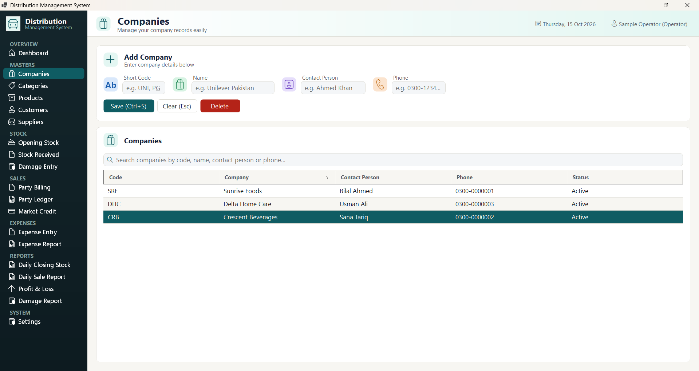
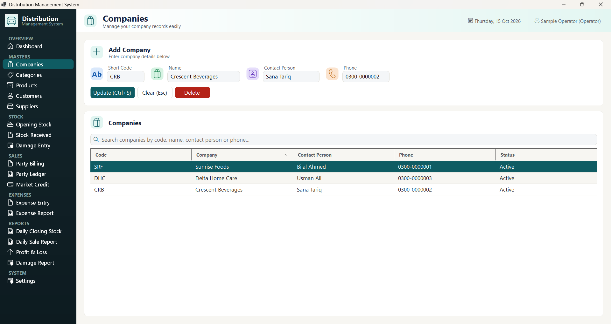

# Troubleshooting

**Distribution Management System — problems, messages and fixes**

Use this guide when something does not work as expected. Messages are quoted exactly as the application shows them. Figure numbers refer to [SCREEN_REFERENCE.md](SCREEN_REFERENCE.md) and `assets/screenshots/`.

Items marked **(not tested)** were identified by examining the application but were not reproduced during testing. Treat them as potential issues that need confirmation.

---

## Contents

1. [Sign-in and start-up](#1-sign-in-and-start-up)
2. [Information looks out of date](#2-information-looks-out-of-date)
3. [The wrong record opens after clicking a row](#3-the-wrong-record-opens-after-clicking-a-row)
4. [Messages when saving forms](#4-messages-when-saving-forms)
5. [Stock quantities are wrong](#5-stock-quantities-are-wrong)
6. [Billing and customer balance problems](#6-billing-and-customer-balance-problems)
7. [Reports and dashboard](#7-reports-and-dashboard)
8. [Excel import problems](#8-excel-import-problems)
9. [Users and passwords](#9-users-and-passwords)
9a. [Notifications and updates](#9a-notifications-and-updates)
10. [Backup and restore](#10-backup-and-restore)
11. [Unexpected error window](#11-unexpected-error-window)
12. [Buttons and keyboard](#12-buttons-and-keyboard)
13. [Mistakes that cannot be undone](#13-mistakes-that-cannot-be-undone)
14. [Information to give your administrator](#14-information-to-give-your-administrator)

---

## 1. Sign-in and start-up

| Problem or Message | Possible Cause | Recommended Action | How to Verify the Fix |
|---|---|---|---|
| **"Invalid username or password."** (Figure 2) | Wrong username or password. Caps Lock is on. Username typed with different capital letters (usernames are case-sensitive). | Check Caps Lock. Retype the username exactly. Click the eye icon to see the password you typed. | The main window opens. |
| Same message, but the details are certainly correct | The account was **deactivated** or the password was **reset** by an administrator. | Ask an Admin to check your account on the **Users** screen and to **Activate** it or **Reset Password**. | You can sign in. |
| Pressing **Enter** in the Username box does nothing | Enter only works in the Password box. | Press **Tab** to go to Password, then press **Enter**, or click **Login (Enter)**. | Sign-in proceeds. |
| An **Error** window appears when the application starts, or the application closes without showing the Sign-in window (not tested) | The application cannot reach its database (database server stopped, network problem, or wrong connection settings). | Contact your system administrator. Give them the time of the problem. Technical details are written to the `logs` folder inside the application folder. | The Sign-in window appears normally. |
| Nobody can sign in as an administrator | The only Admin account was deactivated, or its password is lost. | This cannot be fixed from inside the application. Contact your system administrator. | An Admin can sign in again. |

---

## 2. Information looks out of date

**How refreshing works:** every screen reloads its lists and drop-downs each time you open it from the side menu, and again after you save on that screen. A record added on one screen is therefore available on the others straight away, without restarting the application.

**Report results are the exception.** They depend on the dates and filters you choose, so they are only recalculated when you ask for them.

| Problem | Recommended Action | How to Verify |
|---|---|---|
| A report still shows old figures after new bills, expenses or stock | Click **View Report**, **View Ledger** or **Apply Filter** on that screen. | The figures change. |
| **In Stock**, **Avg Cost** or **Balance** look wrong on Products, Customers or Suppliers | Click another screen and open this one again. If it still looks wrong, type a letter in the search box and delete it. | The figures match the latest transactions. |
| A new company, category, product, customer, supplier, area, damage reason or expense category is missing from a drop-down | Open the screen again (click another menu item, then this one). | The item appears in the list. |
| The item is still missing after reopening the screen | It was probably not saved. Open the screen where you added it and check the list. | The record is in its own list. |
| The selection in a drop-down changed by itself | The record you had chosen was deleted, so the first item was selected instead. | Check the selection before saving. |
| Another user's entries are missing from a "Today's…" list | These lists reload when you open the screen and after you save. Open the screen again. | The other user's entries appear. |
| Entries made just after midnight appear under the previous day's "Today's…" list, or are missing (not tested) | The "Today's" lists use the world standard time (UTC) date. In Pakistan (UTC+5), entries made between 12:00 midnight and 5:00 AM may be grouped with the previous day. | Use **Daily Sale Report** or **Expense Report** with an explicit date instead. |

---

## 3. The wrong record opens after clicking a row

**Verified behaviour:** on the Companies screen, the list was sorted by clicking the **Company** heading. Clicking the row **SRF – Sunrise Foods** then loaded **CRB – Crescent Beverages** into the form (Figures 107 and 108). Saving or deleting at that point would change the wrong company.

**Figure 107: The Companies list after clicking the Company heading twice (sorted Z to A)**

**Figure 108: The SRF – Sunrise Foods row was clicked, but the form shows CRB – Crescent Beverages**

This can happen on any master screen: Companies, Categories, Products, Customers, Suppliers and Users.

| Problem or Message | Possible Cause | Recommended Action | How to Verify the Fix |
|---|---|---|---|
| The form shows a different record from the row you clicked | The list was sorted by clicking a column heading. | Click **Clear (Esc)**. Type a letter in the search box and delete it (this restores the normal order). Click the row again. **Do not click column headings** on these screens. | The code and name in the form match the row you clicked. |
| You already clicked **Update** or **Delete** on the wrong record | As above. | **Update:** open the affected record and correct its values. **Delete:** it cannot be restored from the application; inform your administrator. | The record shows the correct values. |

> **Good practice:** before every **Update** or **Delete**, read the code and name shown in the form.

---

## 4. Messages when saving forms

Red messages appear at the bottom-right for about two seconds.

| Problem or Message | Screen | Possible Cause | Recommended Action |
|---|---|---|---|
| "Code and Name are required." | Companies | Short Code or Name empty | Fill both fields. |
| "Name is required." | Categories | Name empty | Type a name. |
| "Code, Name, Company, Category and Unit are required." | Products | A required field empty, or no companies/categories exist | Fill all five. If the drop-downs are empty, add companies and categories first, then open Products again. |
| "Code, Shop Name and Area are required." | Customers | A required field is empty, or no area exists | Add an area with the **+** button. |
| "Code, Name and Company are required." | Suppliers | A required field empty | Fill them. |
| "Select a product." | Opening Stock, Stock Received, Party Billing | No product chosen or no products exist | Choose a product; add products first if the list is empty. |
| "Quantity must be greater than zero." | Opening Stock, Damage Entry | Qty is 0 | Enter a quantity. |
| "Qty and Rate must be greater than zero." | Stock Received, Party Billing | Qty or Rate is 0 when clicking **Add Line** | Enter both. On Party Billing, a 0 rate usually means the product's **Sale Rate** is 0. Set it on Products. |
| "Supplier and Invoice No are required." | Stock Received | Invoice No empty | Type the supplier invoice number. |
| "Add at least one item line." | Stock Received | No lines added | Click **Add Line** for each item first. |
| "Add at least one item." | Party Billing | No lines added | Add lines first. |
| "Select a customer." | Party Billing | No customer chosen or none exist | Add customers first. |
| "Product, Reason and Found At are required." | Damage Entry | Reason list empty | Click **+** next to Reason and add one. |
| "Category and Amount are required." | Expense Entry | No category, or Amount is 0 | Choose or add a category; enter an amount above 0. |
| "Username and Full Name are required." | Users | Field empty | Fill both. |
| "Username already exists." | Users | Username taken | Choose another username. |
| Error window "An unexpected error occurred: 23505: duplicate key value violates unique constraint "IX_…_Code"" (Figure 13) | Companies, Products, Customers, Suppliers | The code is already used, **including by a deleted record** | Click **OK**. Change the code (for example add `-2`). Codes of deleted records cannot be reused. |
| A long text is refused with an "unexpected error" window (not tested) | Text longer than the allowed length (for example a name over 200 characters) | Click **OK** and shorten the text. | — |
| No message at all, nothing saved | The message appeared while you looked away | Check the list. If the record is missing, save again and watch the bottom-right corner. | — |

---

## 5. Stock quantities are wrong

| Problem or Message | Possible Cause | Recommended Action | How to Verify the Fix |
|---|---|---|---|
| **In Stock** shows 0 or an old number | Screen not refreshed (see [Section 2](#2-information-looks-out-of-date)) | Type and delete a letter in the search box. | Correct quantity shown. |
| "Insufficient stock for '…'. Available: …, requested: …." (Figures 65, 74) | You are selling or writing off more than the recorded stock | Check the quantity. If goods really arrived, record the delivery on **Stock Received** first. **Allow negative stock** in Settings has no effect in this version. | The bill or damage entry saves. |
| Opening stock entered twice for a product | Each Opening Stock save **adds** stock, and entries cannot be deleted | Record the extra quantity on **Damage Entry** with a remark such as "Correction – duplicate opening stock", and inform your administrator. (This also records a loss in reports, so note it for your accountant.) | Products → In Stock matches the physical count. |
| A purchase was saved twice | Duplicate invoice numbers are not blocked, and purchases cannot be deleted | As above: record the extra quantity as damage with a clear remark, and inform your administrator. The bilti expense of the duplicate also needs attention. | In Stock matches the count. |
| Stock disappeared from Daily Closing Stock | The product was deleted | Deleted products cannot be restored from the application. Contact your administrator. | — |
| Quantities with decimals look rounded (for example 2.5 shown as 3) | Lists show whole numbers | The exact value is stored. Open the record to see it, where possible. | — |

---

## 6. Billing and customer balance problems

| Problem or Message | Possible Cause | Recommended Action | How to Verify the Fix |
|---|---|---|---|
| "Discount X% exceeds max allowed Y% for …." (Figure 106) | Operator or Viewer exceeded the product's **Max Discount %** | Reduce the discount (Clear and re-add the lines), or ask an Admin. An Admin can raise the product's Max Discount % on Products. | The bill saves. |
| Rate shows 0.00 when a product is chosen | The product's Sale Rate is 0 | Type the rate for this bill, or set the Sale Rate on Products and open Party Billing again. | Rate fills in correctly. |
| A wrong line was added | There is no way to remove one line | Click **Clear (Esc)** and add all lines again. | Lines are correct. |
| A saved bill is wrong | Bills cannot be edited or cancelled | Inform your administrator. To correct the customer's account, adjust carefully with a manager. There is no return or credit-note screen in this version. | — |
| Need to print a bill | Printing an individual bill is not available | Note the bill number. The **Daily Sale Report** lists every bill and can be printed or exported ([W29](WORKFLOW_GUIDES.md#w29-export-or-print-a-report)). | — |
| The customer's **Default Discount %** was not applied | It is stored for reference only | Enter the discount on each line. | — |
| A customer paid without buying | — | Use **SALES → Receive Payment** ([W15](WORKFLOW_GUIDES.md#w15-record-a-payment-against-a-customers-balance)). | The balance drops and a receipt appears in the ledger. |
| The whole bill went on credit | **Cash Received** was left at 0, so nothing was treated as paid | Type the money collected into **Cash Received** before saving. For an already-saved bill, record the payment on **Receive Payment**. | The message after saving says "Fully paid", or the balance drops after the receipt. |
| A receipt was saved with the wrong amount or customer | Receipts cannot be edited or deleted | Inform your administrator before entering anything else. | — |
| Previous Balance looks wrong | A bill or receipt was saved on another screen after this one was opened | Open Party Billing again; it reloads the balances. Compare with Party Ledger. | Matches the ledger's last running balance. |
| A customer who owes money is missing from Market Credit | The customer was deleted, or their balance is zero or negative | Click **Refresh** on Market Credit. Deleted customers are never shown. | Customer appears. |
| Bill numbers do not use my Invoice Prefix | The prefix setting is not used in this version | No action. Bills are always numbered BILL-00001, BILL-00002, … | — |

---

## 7. Reports and dashboard

| Problem or Message | Possible Cause | Recommended Action |
|---|---|---|
| Dashboard always shows **Rs 0** and "No bills found for today" (Figure 91) | The dashboard figures are not connected to data in this version | Use the reports listed in [SCREEN_REFERENCE.md, Dashboard](SCREEN_REFERENCE.md#3-dashboard). |
| Pressing **F2** does not open a new bill | Keyboard shortcut not active | Click **New Bill (F2)** or **Party Billing**. |
| Export or print buttons are missing on a screen | Only report screens have them (Daily Closing Stock, Daily Sale Report, Profit & Loss, Damage Report, Expense Report, Party Ledger, Market Credit) | Masters and entry screens cannot be exported. Use the matching report. |
| "There is nothing to export for the selected options." | The report is empty for those dates or filters | Widen the dates, clear the filters, click **View Report**, then export. |
| "Click View Ledger first." | Party Ledger has not been run | Choose a customer and dates, click **View Ledger**, then export. |
| The exported file will not save | The file is open in Excel or a PDF reader | Close it, or save under another name. |
| "No printer is installed on this computer." | No printer available | Use **Export PDF** instead and print elsewhere. |
| The exported report shows "Distribution Management System" instead of my business name | **Company Name** is empty in Settings | Enter your business details in **Settings → Save Settings** ([W26](WORKFLOW_GUIDES.md#w26-update-company-settings)), then export again. |
| Profit & Loss does not change after ticking a checkbox | Checkboxes apply only when the report is recalculated | Click **View Report**. |
| **Self Expenses** is always 0 | Expense categories created in the application are always business categories | No action possible in this version. |
| **Expense Report** summary did not include a new expense | The summary refreshes when the screen opens and on **Apply Filter** | Click **Apply Filter**. |
| Damage Report does not change after choosing a different **Group By** | Recalculation needed | Click **View Report**. |
| Daily Sale Report product-wise and company-wise totals are higher than the bill-wise Net | Bill-level discounts are only subtracted in the bill-wise section | Expected behaviour. Use the bill-wise Net for daily sales. |
| Daily Closing Stock **Value** for a past date differs from what it showed that day | **Avg Cost** is always today's average cost | Expected behaviour. |
| Opening stock appears under **Received** instead of **Opening** | The opening stock **As On Date** is the same as the report date | Report on a later date, or use an earlier As On Date when entering opening stock. |
| Supplier **Payable Balance** never changes | It shows only the opening balance; purchases and payments are not tracked | Keep supplier accounts separately. |
| Report shows nothing | No data for the chosen dates, or filters too narrow | Widen the dates; choose **All companies** / **All categories**; click View Report. |

---

## 8. Excel import problems

| Problem or Message | Possible Cause | Recommended Action | How to Verify the Fix |
|---|---|---|---|
| "Row 1: Missing required column(s): …" | A heading is missing or misspelled | Correct row 1. Required: Code, Name, Company, Category, Unit, PcsPerUnit, PurchaseRate, SaleRate. | Import runs with rows processed. |
| "Row N: Unknown company '…'. Add it under Masters > Companies first." (Figure 30) | Company name in the file does not match | Fix the spelling in the file, or add the company under Masters → Companies. | Row imports. |
| "Row N: Unknown category '…'. Add it under Masters > Categories first." | Category not found | As above. | Row imports. |
| "Row N: Unit must be one of: Ctn, Box, Pcs, Bag." (Figure 30) | Invalid unit (for example "Crate") | Use one of the four units. | Row imports. |
| "Row N: PcsPerUnit, PurchaseRate and SaleRate must be numeric." | Text or symbols in a number cell | Enter plain numbers (no "Rs"). | Row imports. |
| "Row N: Code and Name are required." | Blank code or name | Fill them. | Row imports. |
| "Import failed: …" | File open in Excel, not a real .xlsx file, or damaged | Close Excel and try again. Save as **Excel Workbook (.xlsx)**. | Result message appears. |
| Barcodes or max discounts disappeared after import | The file had no Barcode or MaxDiscountPct column, or blank cells | Add the columns with values and import again. | Values return. |
| Only some rows were imported | Rows with errors are skipped; other rows **are** saved | Fix the listed rows and import again. Existing codes are updated, not duplicated. | All rows present. |

---

## 9. Users and passwords

| Problem | Possible Cause | Recommended Action |
|---|---|---|
| The **Users** menu item is missing | You are not an Admin (Figure 105) | Ask an Admin. |
| A user forgot their password | — | Admin: [WORKFLOW_GUIDES.md, W24](WORKFLOW_GUIDES.md#w24-reset-a-forgotten-password). |
| A user wants to change their own password | No self-service password change | Ask an Admin to use **Reset Password**. |
| A new user unexpectedly has full access | The **Role** drop-down defaults to **Admin** | Admin: open the user, change **Role** to Operator or Viewer, click **Update**. The change applies at the next sign-in. |
| A Viewer can create bills and change data | The Viewer role is not read-only in this version (not tested; see [USER_MANUAL.md, Section 14](USER_MANUAL.md#14-user-roles-and-permissions)) | Give the Viewer role only to trusted staff. |
| Role change did not apply | The user is still signed in | Ask them to close the application and sign in again. |
| Passwords are visible while typing in Set Password / Reset Password | The input window does not hide characters | Make sure no one is watching the screen. |

---

## 9a. Notifications and updates

| Problem or Message | Possible Cause | Recommended Action | How to Verify the Fix |
|---|---|---|---|
| No bell appears at the top | Nothing has been sent yet, this PC is offline, or notifications are switched off for it | Check the internet connection. Ask your supplier whether anything was sent. | The bell appears with a number. |
| A message shows buttons such as "Open picture" instead of the poster or video | The Microsoft Edge WebView2 Runtime is not installed on this PC | Ask your supplier or IT person to install the free **Microsoft Edge WebView2 Runtime**. The buttons work in the meantime. | The poster and video appear inside the window. |
| The video will not play | The file is not MP4, or the PC cannot reach it | Tell your supplier. They can send it again as MP4. | The video plays. |
| A message vanished | Your supplier removed it, or it expired | Nothing to do. | — |
| The bell number does not go down | The message was not opened, only hovered | Click the message in the list, or use **Mark all as read**. | The red dots clear. |
| "You already have the latest version" but your supplier says there is a new one | The new version has not finished publishing, or this PC is offline | Wait a few minutes and check again. | The update window appears. |
| "This copy was not installed by the setup program, so it cannot update itself." | The application is running from a copied folder, not an installed copy | Ask your supplier for `Setup.exe` and install it properly. | **Check for Updates** offers the update. |
| "Updates are switched off for this computer." | Set on purpose for this site | Ask your supplier if it should be changed. | — |
| "Download failed: …" | The connection dropped during the download | Click **Try Again**. | The download finishes. |
| After an update the application asks to be set up again | The file `C:\ProgramData\DistributionManagementSystem\appsettings.json` was deleted | Your supplier must enter the database details again in that file. | The application starts normally. |
| Windows warns "Windows protected your PC" when running the installer | The installer is not code-signed | Click **More info → Run anyway**, but only for a file you received from your supplier. | The installer runs. |

---

## 10. Backup and restore

| Problem or Message | Possible Cause | Recommended Action | How to Verify the Fix |
|---|---|---|---|
| "Backup failed: An error occurred trying to start process 'pg_dump' … The system cannot find the file specified." (verified) | PostgreSQL client tools are not installed or not available to Windows | System administrator: install the PostgreSQL client tools and add their folder to the Windows PATH, then restart the application. | "Backup created successfully." |
| "Backup failed: pg_dump failed: …" (not tested) | Database connection or permission problem, or the target folder is not writable | Try another folder (for example Documents). If it persists, contact the system administrator with the message text. | Backup succeeds. |
| "Restore failed: …" (not tested) | Missing tools, wrong or damaged file | Do not retry repeatedly. Contact the system administrator. | — |
| After "Database restored. Please restart the application." the data looks strange | The application was not restarted | Close and restart the application. | Data reflects the backup. |

---

## 11. Unexpected error window

**Window title:** **Error**. **Message:** "An unexpected error occurred:" followed by technical text. Button: **OK**.

| What to do | Details |
|---|---|
| 1. Read and note the message | Write down the first line (for example "23505: duplicate key value…"). |
| 2. Click **OK** | The application normally keeps running. |
| 3. Check whether your last action was saved | Look in the relevant list. In the duplicate-code case, nothing was saved. |
| 4. Fix and retry, or report | Duplicate code: change the code. Other errors: report to your administrator with the time and what you were doing. |

> Several Error windows may open one after another. Click **OK** on each.

---

## 12. Buttons and keyboard

| Problem | Explanation | Recommended Action |
|---|---|---|
| **Ctrl+S**, **Esc** or **F2** do nothing | The shortcuts shown on button labels are not active in this version | Click the buttons with the mouse. |
| **Delete**, **Reset Password** or **Deactivate** looks clickable but nothing happens | These buttons work only after you click a row (edit mode). Disabled buttons look the same as enabled ones. | Click a row in the list first. |
| Typed number disappears | Invalid characters were typed | Type digits and a decimal point only. Press **Enter** or **Tab** to confirm. |
| Number changed by itself (for example 150 → 100) | The value was outside the allowed range | Enter a value within the range (for example 0–100 for percentages). |
| Cannot see the lower part of a screen | The screen is taller than the window | Scroll with the mouse wheel or the scroll bar on the right. |
| Search on Companies does not find a contact person or phone | Company search uses code and name only | Search by code or name. |
| A drop-down lost my selection when I came back to a screen | The screen reloaded its list and the record you had chosen no longer exists | Check the selection before saving. |

---

## 13. Mistakes that cannot be undone

The following actions **cannot be edited, reversed or deleted** from inside the application. Double-check before saving:

| Action | Consequence |
|---|---|
| Save Bill (Party Billing) | Bill, stock reduction and receipt are permanent. |
| Save Purchase (Stock Received) | Stock increase, cost change and bilti expense are permanent. |
| Save Opening Stock | Stock addition is permanent. |
| Save Damage Entry | Stock reduction and loss are permanent. |
| Save Expense | Expense is permanent. |
| Save Receipt (Receive Payment) | The payment and the reduced balance are permanent. |
| Delete a company, category, product, customer or supplier | Record is hidden permanently; its code cannot be reused. |
| Restore Database | All current data is replaced by the backup. |
| Restart Now (software update) | The application closes at once. Anything typed but not saved is lost. The update itself can only be undone by your supplier publishing a newer version. |

If one of these was done by mistake, stop and inform your administrator before entering more data.

---

## 14. Information to give your administrator

When reporting a problem, include:

1. Your username and the time the problem happened.
2. The screen name (top of the window) and what you clicked.
3. The exact message text (or a photo of the screen).
4. Example data involved (bill number, product code, customer code).
5. Whether the problem happens every time.

The application writes technical details to daily files in the `logs` folder next to the application program. Your administrator can use them.
