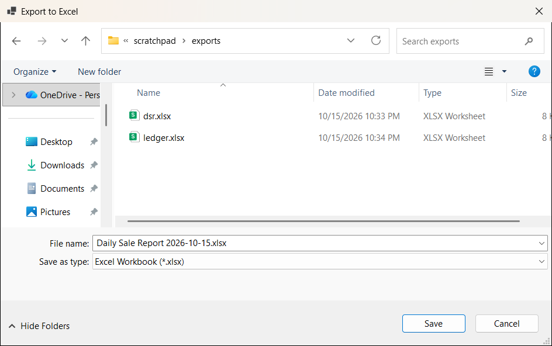
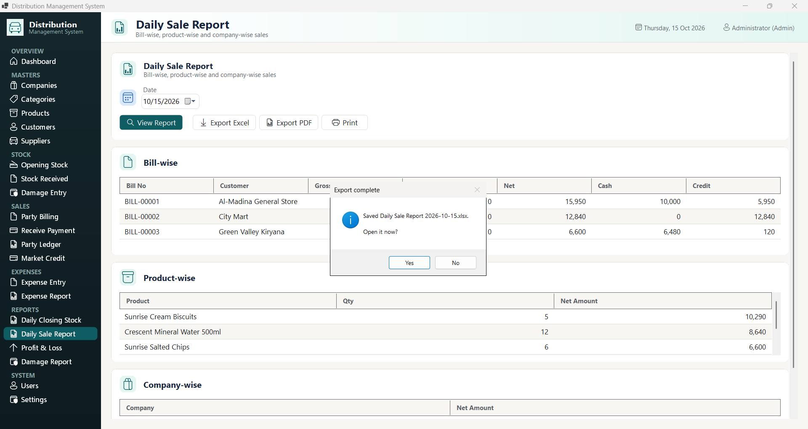
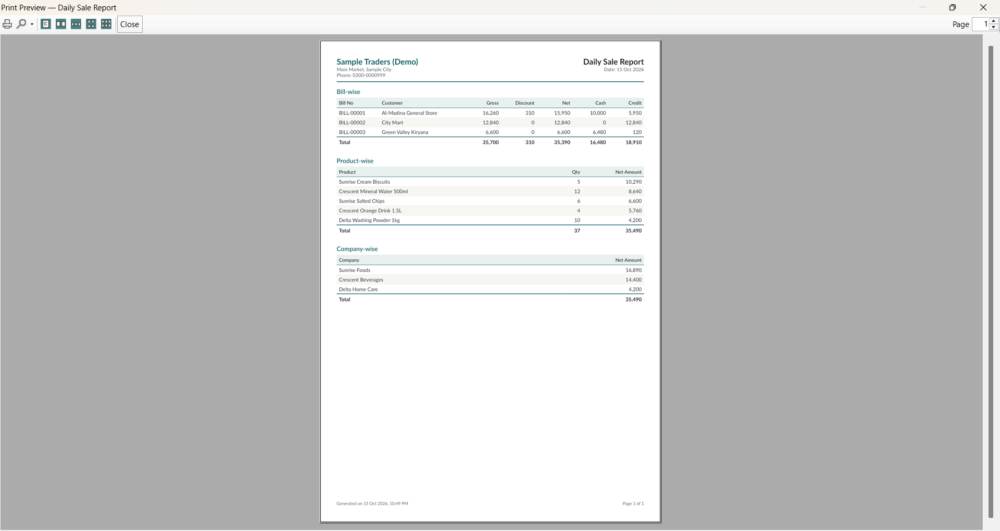
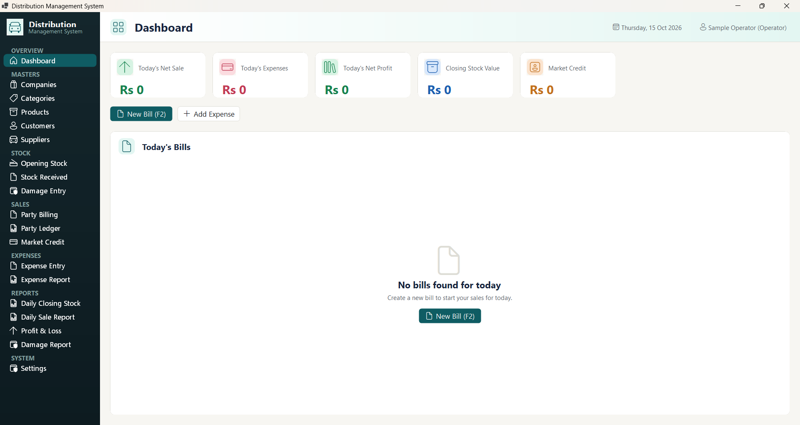

# Software User Manual

## Distribution Management System

**Desktop application for Windows · Manual version 1.2 · Updated 16 October 2026**

This manual explains how to use the Distribution Management System. It is written for the people who use the application every day (owners, operators, store keepers, salespeople and administrators), not for programmers.

### Documentation set

| Document | Use it for |
|---|---|
| **USER_MANUAL.md** (this file) | Introduction, getting started, navigation, roles, messages, FAQ, glossary and quick reference |
| [SCREEN_REFERENCE.md](SCREEN_REFERENCE.md) | Every screen, every field and every button in detail, with screenshots |
| [WORKFLOW_GUIDES.md](WORKFLOW_GUIDES.md) | Step-by-step procedures for complete business tasks |
| [TROUBLESHOOTING.md](TROUBLESHOOTING.md) | Error messages and problems, and how to fix them |
| [DOCUMENTATION_COVERAGE.md](DOCUMENTATION_COVERAGE.md) | What was documented and verified, and what still needs checking |

---

## Contents

1. [Introduction](#1-introduction)
2. [Purpose and Scope](#2-purpose-and-scope)
3. [Intended Audience](#3-intended-audience)
4. [System Access and Getting Started](#4-system-access-and-getting-started)
5. [Signing In and Closing the Application](#5-signing-in-and-closing-the-application)
6. [Main Interface and Navigation](#6-main-interface-and-navigation)
7. [Dashboard](#7-dashboard)
8. [Screen-by-Screen Guide (summary)](#8-screen-by-screen-guide-summary)
9. [Form Reference (summary)](#9-form-reference-summary)
10. [End-to-End Workflow Guides (summary)](#10-end-to-end-workflow-guides-summary)
11. [Search, Filters, Tables and Record Management](#11-search-filters-tables-and-record-management)
12. [Reports, Printing and Exports](#12-reports-printing-and-exports)
13. [Settings](#13-settings)
14. [User Roles and Permissions](#14-user-roles-and-permissions)
15. [Notifications, Messages and Confirmations](#15-notifications-messages-and-confirmations)
16. [Error Handling and Troubleshooting](#16-error-handling-and-troubleshooting)
17. [Frequently Asked Questions](#17-frequently-asked-questions)
18. [Keyboard Use](#18-keyboard-use)
19. [Glossary of Application Terms](#19-glossary-of-application-terms)
20. [Quick Reference Guide](#20-quick-reference-guide)
21. [Documentation Coverage](#21-documentation-coverage)

---

## 1. Introduction

The **Distribution Management System** helps a goods distribution business (a wholesaler or distributor supplying shops) keep track of:

- **Masters:** the companies (brands) you distribute, product categories, products and prices, customers (shops) and suppliers.
- **Stock:** opening stock, deliveries received from suppliers, and damaged or lost goods.
- **Sales:** bills to customers, cash received, and customer balances (credit).
- **Expenses:** business spending, including freight (bilti).
- **Reports:** daily closing stock, daily sales, profit and loss, damage and expenses.

The application runs on a Windows computer and stores its data in a central database that your system administrator sets up. Several computers can use the same database.


**Figure 3: Main window after signing in**

---

## 2. Purpose and Scope

**This manual covers** every screen and feature available in the current version of the application:

- Sign-in window
- Dashboard
- Masters: Companies, Categories, Products (including Import from Excel), Customers, Suppliers
- Stock: Opening Stock, Stock Received, Damage Entry
- Sales: Party Billing, Party Ledger, Market Credit
- Expenses: Expense Entry, Expense Report
- Reports: Daily Closing Stock, Daily Sale Report, Profit & Loss, Damage Report
- System: Users, Settings (including Backup and Restore and Software Update)
- Notifications from your supplier
- Automatic software updates

**This manual does not cover** installation, database setup, server configuration or programming. These are tasks for your system administrator.

**Features not available in this version.** Users often expect the following, but they are **not** in the current version:

| Not available | What to do instead |
|---|---|
| Printing or exporting an individual **bill** | Reports can be printed and exported (see [Section 12](#12-reports-printing-and-exports)), but a single bill cannot. Note the bill number and use the Daily Sale Report or Party Ledger. |
| Editing, cancelling or deleting saved bills, purchases, stock entries, damage entries, expenses or receipts | Check carefully before saving. See [TROUBLESHOOTING.md, Section 13](TROUBLESHOOTING.md#13-mistakes-that-cannot-be-undone). |
| Sale returns and purchase returns | Not available. Contact your administrator. |
| Supplier payments and supplier balance tracking | Keep supplier accounts separately. |
| Sign out button | Close the window and start the application again. |
| Replying to a notification | Notifications are one-way. Phone your supplier to reply. |
| Changing your own password | Ask an Admin to use **Reset Password**. |
| Working dashboard figures | Use the report screens. |

---

## 3. Intended Audience

| Reader | Typical tasks | Most useful sections |
|---|---|---|
| **Business owner / manager** | Reviewing sales, profit, stock, credit and damage | Sections 7, 12; Workflows W17, W20–W22 |
| **Operator / data entry staff** | Entering bills, deliveries, expenses and master records | Sections 5, 6, 11, 15; Workflows W3–W14, W18 |
| **Store keeper** | Receiving stock, recording damage, checking stock | Workflows W11–W13, W20 |
| **Administrator** | First-time setup, users, settings, backups | Sections 4, 13, 14; Workflows W1, W23–W28 |

You need basic computer skills: using a mouse, typing, and opening programs. No accounting or technical knowledge is required. Business terms are explained in the [Glossary](#19-glossary-of-application-terms).

---

## 4. System Access and Getting Started

### What you need

- A Windows computer with the application installed by your system administrator.
- A screen resolution of at least **1366 × 768** pixels (the main window cannot be smaller).
- A **username** and **password** created by an administrator.
- A working connection to the application's database (usually the office network).

### Starting the application

1. Double-click the application's icon (or the program file `Distribution.WinForms.exe`) provided by your administrator.
2. The **Sign in — Distribution Management System** window appears. See [Section 5](#5-signing-in-and-closing-the-application).

### First use on a new installation (administrator only)

When the application is started for the very first time on an empty database, it creates **one administrator account automatically**:

- **Username:** `admin`
- **Full Name:** Administrator
- **Role:** Admin
- **Initial password:** written by the application into its log file on that first start (the `logs` folder next to the program file, in a line beginning "No users existed. Created default admin account…"). Your installer or system administrator can give it to you. It is not printed in this manual for security reasons.

> **Security — do this immediately after the first sign-in:**
> 1. Open **Users**, click the **admin** row, click **Reset Password**, and set a strong new password ([W24](WORKFLOW_GUIDES.md#w24-reset-a-forgotten-password)).
> 2. Create a separate account for each person ([W23](WORKFLOW_GUIDES.md#w23-create-a-staff-login)). Do not share accounts.

Then follow the complete setup order in [W1: First-time setup](WORKFLOW_GUIDES.md#w1-first-time-setup-of-the-application):

**Settings → Companies → Categories → Products → Customers (with areas) → Suppliers → Opening Stock → Backup.**

---

## 5. Signing In and Closing the Application

### Signing in


**Figure 1a: Sign-in window**

1. Type your **Username** (1). Capital and small letters must match.
2. Type your **Password** (2). Click the eye icon (3) to show or hide it.
3. Press **Enter** (while in the Password box) or click **Login (Enter)** (4).
4. The main window opens on the Dashboard. Your name and role appear at the top-right.

If you see **"Invalid username or password."** (Figure 2), check your typing and Caps Lock. A deactivated account shows the same message. See [TROUBLESHOOTING.md, Section 1](TROUBLESHOOTING.md#1-sign-in-and-start-up).

### Closing the application (signing out)

There is no Sign out button.

1. Save any work in progress. **Unsaved forms are lost.**
2. Click the **X** at the top-right of the main window.
3. To sign in as someone else, start the application again.

> **Tip:** Closing the application and signing in again is also the way to make every screen show fresh data. See [Section 6](#6-main-interface-and-navigation).

---

## 6. Main Interface and Navigation


**Figure 3a: Main window: (1) side menu, (2) screen title, (3) today's date, (4) signed-in user, (5) summary cards, (6) New Bill, (7) Add Expense, (8) Today's Bills**

### Parts of the window

| Part | Description |
|---|---|
| **Side menu** (left, dark green) | Click any item to open that screen. The current screen is highlighted. Items are grouped: **OVERVIEW, MASTERS, STOCK, SALES, EXPENSES, REPORTS, SYSTEM**. |
| **Top bar** | Shows the open screen's name and description, the notification bell (when you have messages), today's date, and your name with your role in brackets. |
| **Work area** | The open screen. Most screens have a form at the top (cards with fields and buttons) and a list below. |

### Menu structure

```
OVERVIEW   Dashboard
MASTERS    Companies · Categories · Products · Customers · Suppliers
STOCK      Opening Stock · Stock Received · Damage Entry
SALES      Party Billing · Receive Payment · Party Ledger · Market Credit
EXPENSES   Expense Entry · Expense Report
REPORTS    Daily Closing Stock · Daily Sale Report · Profit & Loss · Damage Report
SYSTEM     Users (Admin only) · Settings
```

### How screens behave when you move between them

- A screen keeps whatever you typed when you switch to another screen and back.
- **Every screen reloads its lists and drop-downs each time you open it.** A customer, supplier or product added on one screen is available on the others straight away, without restarting the application.
- Your current selection is kept where it still exists. For example, if you were part-way through a bill, the customer you had chosen stays chosen.
- The only lists that do **not** reload on their own are report results, because they depend on the dates and filters you choose. Click **View Report**, **View Ledger** or **Apply Filter** to recalculate them.

Full details: [SCREEN_REFERENCE.md, Section 2](SCREEN_REFERENCE.md#2-main-window-and-navigation).

### Typical screen layout

Most data-entry screens follow the same pattern (Figure 9a):

1. **Form card** with fields at the top.
2. **Buttons**: **Save** (changes to **Update** when editing), **Clear**, **Delete**.
3. **List card** with a search box and a table. Clicking a row loads it into the form.

---

## 7. Dashboard

The Dashboard is the first screen after signing in (Figure 3).

| Element | Use |
|---|---|
| **New Bill (F2)** | Opens Party Billing. |
| **Add Expense** | Opens Expense Entry. |
| Summary cards (Today's Net Sale, Today's Expenses, Today's Net Profit, Closing Stock Value, Market Credit) | **In this version these always show Rs 0.** |
| **Today's Bills** | **In this version this always shows "No bills found for today".** |

For real figures, use the report screens. See [SCREEN_REFERENCE.md, Section 3](SCREEN_REFERENCE.md#3-dashboard) for a table showing which report replaces each card.

---

## 8. Screen-by-Screen Guide (summary)

Each screen is documented in full, with screenshots, in [SCREEN_REFERENCE.md](SCREEN_REFERENCE.md).

| Screen | Menu | What it is for | Details |
|---|---|---|---|
| Sign-in window | — | Enter username and password | [§1](SCREEN_REFERENCE.md#1-sign-in-window) |
| Main window | — | Menu, top bar, work area | [§2](SCREEN_REFERENCE.md#2-main-window-and-navigation) |
| Dashboard | OVERVIEW | Shortcuts to new bill and new expense | [§3](SCREEN_REFERENCE.md#3-dashboard) |
| Companies | MASTERS | Brands / manufacturers | [§4](SCREEN_REFERENCE.md#4-companies) |
| Categories | MASTERS | Product groups | [§5](SCREEN_REFERENCE.md#5-categories) |
| Products | MASTERS | Items, prices, discount limits, stock; Excel import | [§6](SCREEN_REFERENCE.md#6-products) |
| Customers | MASTERS | Shops / parties, areas, opening balances | [§7](SCREEN_REFERENCE.md#7-customers) |
| Suppliers | MASTERS | Parties you buy from | [§8](SCREEN_REFERENCE.md#8-suppliers) |
| Opening Stock | STOCK | Starting stock quantities and costs | [§9](SCREEN_REFERENCE.md#9-opening-stock) |
| Stock Received | STOCK | Deliveries from suppliers, freight | [§10](SCREEN_REFERENCE.md#10-stock-received) |
| Damage Entry | STOCK | Damaged, expired or lost goods | [§11](SCREEN_REFERENCE.md#11-damage-entry) |
| Party Billing | SALES | Sale bills and cash received | [§12](SCREEN_REFERENCE.md#12-party-billing) |
| Receive Payment | SALES | Payments received against a customer's balance | [§12a](SCREEN_REFERENCE.md#12a-receive-payment) |
| Party Ledger | SALES | One customer's account history | [§13](SCREEN_REFERENCE.md#13-party-ledger) |
| Market Credit | SALES | All customers who owe money | [§14](SCREEN_REFERENCE.md#14-market-credit) |
| Expense Entry | EXPENSES | Record spending | [§15](SCREEN_REFERENCE.md#15-expense-entry) |
| Expense Report | EXPENSES | Spending by period and category | [§16](SCREEN_REFERENCE.md#16-expense-report) |
| Daily Closing Stock | REPORTS | Stock movement and closing value for a day | [§17](SCREEN_REFERENCE.md#17-daily-closing-stock) |
| Daily Sale Report | REPORTS | Bill-, product- and company-wise sales for a day | [§18](SCREEN_REFERENCE.md#18-daily-sale-report) |
| Profit & Loss | REPORTS | Profit for a period | [§19](SCREEN_REFERENCE.md#19-profit--loss) |
| Damage Report | REPORTS | Damage grouped by product, company, reason or month | [§20](SCREEN_REFERENCE.md#20-damage-report) |
| Users | SYSTEM | Logins, roles, passwords (Admin only) | [§21](SCREEN_REFERENCE.md#21-users) |
| Settings | SYSTEM | Business details, backup and restore, software update | [§22](SCREEN_REFERENCE.md#22-settings) |
| Notifications window | Bell in the top bar | Messages from your supplier | [§22a](SCREEN_REFERENCE.md#22a-notifications-window) |
| Software Update window | Appears by itself, or from Settings | Installing a new version | [§22b](SCREEN_REFERENCE.md#22b-software-update-window) |

---

## 9. Form Reference (summary)

Every form has a field-by-field table (purpose, required/optional, how to enter, validation) in [SCREEN_REFERENCE.md](SCREEN_REFERENCE.md). Required fields at a glance:

| Form | Required fields | Unique fields |
|---|---|---|
| Add Company | Short Code, Name | Short Code |
| Add Category | Name | — |
| Products | Code, Name, Company, Category, Unit | Code |
| Customer | Code, Shop Name, Area / Route | Code |
| Supplier | Code, Name, Company | Code |
| Opening Stock | Product, Qty (> 0) | — |
| Stock Received | Supplier, Invoice No, at least one line (Product, Qty > 0, Rate > 0) | — |
| Damage Entry | Product, Qty (> 0, ≤ stock), Reason, Found At | — |
| Party Billing | Customer, at least one line (Product, Qty > 0, Rate > 0) | — |
| Receive Payment | Customer, Amount Received (> 0) | — |
| Expense Entry | Category, Amount (> 0) | — |
| Add User | Username, Full Name, Role, password | Username |
| Settings | none | — |

> **Codes of deleted records stay reserved.** You cannot reuse the code of a deleted company, product, customer or supplier.

---

## 10. End-to-End Workflow Guides (summary)

Full step-by-step instructions, with expected results and recovery steps, are in [WORKFLOW_GUIDES.md](WORKFLOW_GUIDES.md).

**The daily cycle:**

```
Morning     Stock Received (deliveries)  →  Party Billing (sales all day)
During day  Expense Entry (as money is spent) · Damage Entry (when found)
Evening     Sign in again → Daily Sale Report → Daily Closing Stock
            → Profit & Loss → Market Credit → Backup
```

| Task | Guide |
|---|---|
| Set up a new installation | [W1](WORKFLOW_GUIDES.md#w1-first-time-setup-of-the-application) |
| Add companies, categories, products, customers, suppliers | [W3–W8](WORKFLOW_GUIDES.md#w3-add-a-company) |
| Edit or delete master records | [W9](WORKFLOW_GUIDES.md#w9-edit-an-existing-master-record), [W10](WORKFLOW_GUIDES.md#w10-delete-a-master-record) |
| Enter opening stock | [W11](WORKFLOW_GUIDES.md#w11-record-opening-stock) |
| Receive a delivery | [W12](WORKFLOW_GUIDES.md#w12-receive-stock-from-a-supplier) |
| Record damage | [W13](WORKFLOW_GUIDES.md#w13-record-damaged-or-lost-stock) |
| Make a bill | [W14](WORKFLOW_GUIDES.md#w14-create-a-sale-bill) |
| Check a customer's account / who owes money | [W16](WORKFLOW_GUIDES.md#w16-check-a-customers-account), [W17](WORKFLOW_GUIDES.md#w17-see-who-owes-money) |
| Record and review expenses | [W18](WORKFLOW_GUIDES.md#w18-record-an-expense), [W19](WORKFLOW_GUIDES.md#w19-review-expenses) |
| Close the day | [W20](WORKFLOW_GUIDES.md#w20-end-of-day-closing) |
| Profit for a period | [W21](WORKFLOW_GUIDES.md#w21-calculate-profit-for-a-period) |
| Manage users | [W23–W25](WORKFLOW_GUIDES.md#w23-create-a-staff-login) |
| Settings, backup, restore | [W26–W28](WORKFLOW_GUIDES.md#w26-update-company-settings) |

---

## 11. Search, Filters, Tables and Record Management

### Search boxes

| Screen | Search box hint | Actually searches |
|---|---|---|
| Companies | Search companies by code, name, contact person or phone... | **Code and name only** |
| Categories | Search categories... | Name |
| Products | Search by code, name or barcode... | Code, name, barcode |
| Customers | Search customers... | Shop name, code |
| Suppliers | Search suppliers... | Name, code |
| Users | Search users by username or full name... | Username, full name |

**How to search:**

1. Click in the search box above the list.
2. Type part of the name or code, for example `sun`. Capital letters do not matter.
3. The list filters itself about a third of a second after you stop typing. There is no Search button.
4. To show everything again, delete the text.

**Example:** on Companies, typing `sun` shows only *Sunrise Foods* (Figure 15). Typing a contact person's name, such as `Bilal`, shows nothing (Figure 14).

When nothing matches: Customers and Suppliers show "No customers found" / "No suppliers found" (Figure 42). Other screens show an empty list.

### Filters

| Screen | Filters | How to reset |
|---|---|---|
| Products | **All companies**, **All categories** (apply immediately) | Choose **All companies** / **All categories** again |
| Daily Closing Stock | Date, Company, Category | Choose "All…" and click **View Report** |
| Expense Report | From, To, Category | Change and click **Apply Filter** |
| Party Ledger | Customer, From, To | Click **View Ledger** |
| Daily Sale Report | Date | **View Report** |
| Profit & Loss | From, To, With Expenses, Include Self Expense | **View Report** |
| Damage Report | From, To, Group By | **View Report** |

**Example (Products, Figures 27–28):** open the **All companies** list, choose **Sunrise Foods**, and only its two products are shown. Choose **All companies** to see all products again.

### Tables (lists)

- **Read-only:** you cannot type into lists.
- **Open a record:** on master screens (Companies, Categories, Products, Customers, Suppliers, Users), click a row to load it into the form.
- **Sorting:** clicking a column heading sorts the list, but on master screens this can make the **wrong record load** when you click a row (Figures 107–108). **Do not sort master lists.** If you did, reset as described in [TROUBLESHOOTING.md, Section 3](TROUBLESHOOTING.md#3-the-wrong-record-opens-after-clicking-a-row).
- **Paging:** there are no pages. All matching rows are shown; scroll if needed. Some lists show only recent rows: Opening Stock (last 50), Damage Register (last 100), and the "Today's…" lists (today only).
- **Number format:** amounts and quantities are shown as whole numbers with thousands separators.

### Record management at a glance

| Operation | Masters (Companies, Categories, Products, Customers, Suppliers) | Transactions (Opening Stock, Purchases, Damage, Bills, Expenses) | Users |
|---|---|---|---|
| Create | Yes (**Save**) | Yes (**Save**) | Yes (Admin) |
| View | List + click row | Recent/today lists, reports | List |
| Edit | Yes (**Update**) | **No** | Yes (Admin) |
| Delete | Yes, with restrictions (hidden permanently) | **No** | No (deactivate instead) |
| Restore deleted | **No** | — | Activate |

---

## 12. Reports, Printing and Exports

### Available reports

| Report | Menu | Answers the question |
|---|---|---|
| Daily Closing Stock | REPORTS | How much of each product did we have, receive, sell and lose on a given day, and what is it worth? |
| Daily Sale Report | REPORTS | What did we sell on a given day, by bill, by product and by company? |
| Profit & Loss | REPORTS | How much profit did we make in a period? |
| Damage Report | REPORTS | Where are we losing stock, and why? |
| Expense Report | EXPENSES | What did we spend, and on what? |
| Party Ledger | SALES | What is the account history of one customer? |
| Market Credit | SALES | Who owes us money, and how much? |

How each report is calculated is explained in [SCREEN_REFERENCE.md, Sections 13–20](SCREEN_REFERENCE.md#13-party-ledger).

### Printing and exporting reports

Every report screen listed above has three buttons next to **View Report** (or **View Ledger** / **Apply Filter**):

| Button | What it does |
|---|---|
| **Export Excel** | Saves the report as an Excel workbook (.xlsx). Amounts are saved as real numbers, so you can sort and total them in Excel. |
| **Export PDF** | Saves the report as a PDF, with your business name, the date range and page numbers. |
| **Print** | Opens a print preview. Use the printer button in the preview to choose a printer and print. |

**How to export or print a report:**

1. Open the report, choose your date range and filters, and click **View Report** so that the screen shows what you want.
2. Click **Export Excel**, **Export PDF** or **Print**.
3. For an export, choose a folder and file name, then click **Save** (Figure 114). A suggested name with today's date is filled in for you.
4. When it is saved, the application asks **"Open it now?"** (Figure 115). Click **Yes** to open the file, or **No** to keep working.
5. For **Print**, check the preview (Figure 116), then click the printer icon at the top-left, choose your printer and click **Print**.



**Figure 114: Choosing where to save the exported file**



**Figure 115: After a successful export**



**Figure 116: Print preview of the Daily Sale Report**

**Notes**

- The export always matches what is on screen, including the dates and filters you chose.
- If there is nothing to show, the message **"There is nothing to export for the selected options."** appears. Widen the dates or change the filters.
- If no printer is installed, **Print** explains this and suggests Export PDF instead.
- **Individual bills still cannot be printed.** Only reports can.

### Other file features

- **Import from Excel** on Products (import only).
- **Backup Database** and **Restore Database** in Settings.

> **Tip:** the Settings screen says details are "Shown on printed bills". Bill printing is not available, but the business name, address and phone you enter there **do** appear at the top of every exported and printed report.

---

## 13. Settings

Open **Settings** under **SYSTEM** (Figure 104). Full details: [SCREEN_REFERENCE.md, Section 22](SCREEN_REFERENCE.md#22-settings).

| Setting | Effect in this version |
|---|---|
| Company Name, Phone, Address | Stored only. |
| Invoice Prefix | Stored only. Bills are always numbered **BILL-00001**, **BILL-00002**, … |
| Allow negative stock | Stored only. Selling or writing off more than the stock held is **always** refused. |
| Backup Database | Creates a backup file (requires PostgreSQL client tools). |
| Restore Database | **Replaces all data** with a backup file. |

There are no personal preferences (such as language, theme or font size) in this version.

---

## 14. User Roles and Permissions

Each user has one role, chosen by an Admin on the **Users** screen.

| Capability | Admin | Operator | Viewer |
|---|---|---|---|
| Sign in | ✔ | ✔ | ✔ |
| See and use the **Users** screen | ✔ | ✘ (menu item hidden) | ✘ (menu item hidden) |
| All other screens (masters, stock, sales, expenses, reports, settings, backup and restore) | ✔ | ✔ | ✔ |
| Give a line discount above a product's **Max Discount %** | ✔ | ✘ ("Discount …% exceeds max allowed …%") | ✘ |

**Verified during testing:** an Operator does not see **Users** (Figure 105), and is stopped from exceeding Max Discount % (Figure 106).

> **Important — the Viewer role is not read-only.** In this version, Viewers have the same access as Operators: they can create bills, change masters and even restore the database. This was determined by examining the application and was **not tested** with a Viewer sign-in. Give the Viewer role only to people you trust to enter data.

> **Role changes** take effect the next time the user signs in.



**Figure 105: Signed in as an Operator. The SYSTEM group shows only Settings.**

---

## 15. Notifications, Messages and Confirmations

### Pop-up messages ("toasts")

A small coloured box appears at the bottom-right of the window for about two seconds.

| Colour | Meaning | Examples |
|---|---|---|
| **Green** | Success | "Company saved.", "Product updated.", "Bill BILL-00001 saved.", "Purchase saved and stock updated.", "Opening stock saved.", "Damage entry saved.", "Expense saved.", "Area added.", "Reason added.", "Category added.", "User created.", "Password reset.", "User deactivated.", "Settings saved.", "Backup created successfully." |
| **Red** | Refused or failed. The message tells you why. | "Code and Name are required.", "Insufficient stock for '…'. Available: …, requested: ….", "Username already exists.", "Backup failed: …" |

The application also writes a few messages in **red text inside the window**, for example "Invalid username or password." on the Sign-in window.

### Empty-list messages

Shown in the middle of a list when it has nothing to show, for example "No customers found", "No purchases received today", "No opening stock recorded yet", "No damage entries recorded", "No bills yet today", "No expenses today", "No outstanding credit", "No expenses in this range", "No damage in this range", "No products to show", "Select a customer and date range".

### Confirmation windows

| Window title | Question | Buttons |
|---|---|---|
| Confirm delete | "Delete this company?" / "Delete this category?" / "Delete this product?" / "Delete this customer?" / "Delete this supplier?" | **Yes** deletes, **No** cancels |
| Confirm restore | "Restoring will overwrite existing data. Continue?" | **Yes** restores, **No** cancels |

**Deactivate** / **Activate** on Users, and all Save buttons, do **not** ask for confirmation.

### Input windows

| Window title | Label | Opened by |
|---|---|---|
| New Area | Area / route name: | **+** next to Area / Route (Customers) |
| New Damage Reason | Reason name: | **+** next to Reason (Damage Entry) |
| New Expense Category | Category name: | **+** next to Category (Expense Entry) |
| Set Password | Enter an initial password for this user: | **Save** for a new user (Users) |
| Reset Password | Enter a new password for this user: | **Reset Password** (Users) |

Each has **OK** (or **Enter**) and **Cancel** (or **Esc**).

### Information windows

| Window title | When |
|---|---|
| Imported: X, Updated: Y, Errors: Z | Excel import with errors (lists the row problems) |
| Error | "Import failed: …", or "An unexpected error occurred: …" |

---

## 16. Error Handling and Troubleshooting

See [TROUBLESHOOTING.md](TROUBLESHOOTING.md). The most important points:

1. **Read red messages.** They state exactly what is missing or wrong.
2. **Report figures only update when you ask.** Click **View Report**, **View Ledger** or **Apply Filter**.
3. **Check the form before Update or Delete.** Sorting a list can load the wrong record.
4. **An "Error" window** with "An unexpected error occurred" usually means a duplicate code. Click **OK**, change the code and try again.
5. **Transactions cannot be undone.** Check before saving.

---

## 16a. Notifications from Your Supplier

Your supplier can send messages to every shop that uses this software: new offers, price changes,
holiday notices. They may include a poster or a video.

### How you know a message has arrived

A **bell** appears at the top-right of the window with a red number: how many messages you have not
read yet. The application looks for new messages when you start it and about once an hour after
that.


**Figure 117: The bell with three unread messages**

### Reading messages

1. Click the **bell**.
2. The **Notifications** window opens. Messages are listed on the left, newest first.
   - A **red dot** marks a message you have not read.
   - The coloured stripe shows the kind: blue for news, green for an offer, red for something that
     needs your attention.
3. Click a message to read it on the right. It is marked as read straight away.
4. A poster appears above the text. A video has normal play, pause and volume controls.
5. Some messages have a button such as **See the offer**. It opens in your normal web browser.
6. **Mark all as read** clears every red dot at once.
7. Close the window with the **X**.


**Figure 118: A message with a poster**


**Figure 119: A message with a video**

### Points to note

- Messages are **read only**. You cannot reply from here.
- Read and unread is remembered on **this computer**. Another PC in the same shop keeps its own.
- Your supplier can set a message to disappear on a date, and can remove one at any time.
- With no internet the bell simply shows nothing new. Your work is not affected.
- If a picture or video does not appear and you see buttons such as **Open picture** instead, the
  **Microsoft Edge WebView2 Runtime** is missing on that PC. Ask your supplier or IT person to
  install it. The buttons still open the media in your usual programs.

---

## 16b. Software Updates

When your supplier improves the software, your copy offers the update by itself. You do not have to
download anything by hand.

### When an update is ready

A window appears:

> **A new version is available** — You have 1.0.0. New version: 1.0.1


**Figure 120: An update being offered**

| Button | What happens |
|---|---|
| **Download and Install** | Downloads the update and shows the progress. Carry on working while it downloads. |
| **Later** | Closes the window. You are offered it again at the next check. |

After the download finishes the window says **Ready to install**:

| Button | What happens |
|---|---|
| **Restart Now** | Asks you to confirm, then closes the application, installs, and opens the new version. |
| **Restart Later** | The update installs the next time you are offered it and choose to restart. |

> **Save your work first.** Restarting closes the application. Anything typed into a form but not
> saved is lost. Finish or save the bill you are on, then restart.

Your data, your database settings and your customers' balances are **not** affected by an update.

### Checking by hand

1. Open **Settings** under **SYSTEM**.
2. The **Software Update** card shows your installed version.
3. Click **Check for Updates**.


**Figure 121: The Software Update card in Settings**

You may see:

| Message | Meaning |
|---|---|
| "You already have the latest version (1.0.1)." | Nothing to do. |
| The update window | A newer version is ready. |
| "This copy was not installed by the setup program, so it cannot update itself." | The application is being run from a copied folder. Ask your supplier for the installer. |
| "Updates are switched off for this computer." | Your supplier fixed this PC to one version on purpose. |
| "The update check did not work: …" | Usually no internet. Try again later. |

---

## 17. Frequently Asked Questions

**Q: How do I print or save a report?**
A: Open the report, click **View Report**, then use **Export Excel**, **Export PDF** or **Print**. See [Section 12](#12-reports-printing-and-exports).

**Q: How do I print a single bill?**
A: Printing an individual bill is not available in this version. Note the bill number shown in the "Bill BILL-… saved." message. Bill details are in the Daily Sale Report, which can be printed, and in the customer's Party Ledger.

**Q: I made a mistake in a saved bill. How do I correct it?**
A: Saved bills cannot be edited or deleted. Inform your administrator. See [TROUBLESHOOTING.md, Section 13](TROUBLESHOOTING.md#13-mistakes-that-cannot-be-undone).

**Q: A customer came to pay old dues without buying anything. Where do I enter it?**
A: Use **SALES → Receive Payment**. Choose the customer, enter the amount, choose Cash or Bank, and click **Save Receipt**. The balance reduces straight away. See [W15](WORKFLOW_GUIDES.md#w15-record-a-payment-against-a-customers-balance).

**Q: Why does my whole bill go on credit?**
A: A bill only reduces the customer's balance by whatever you type in **Cash Received**. If you leave it at 0, the full amount is added to their account. Enter the cash collected before saving, or record it later with **Receive Payment**. After saving, the message tells you exactly how much went on credit.

**Q: Why does the Dashboard show Rs 0?**
A: The dashboard figures are not connected to data in this version. Use Daily Sale Report, Profit & Loss, Daily Closing Stock and Market Credit.

**Q: I added a new customer but cannot find them in Party Billing.**
A: Open Party Billing again (click another screen, then Party Billing). Screens reload their lists each time you open them. If it still does not appear, check that the customer was saved on the Customers screen.

**Q: Why does Products show 0 in stock after I received goods?**
A: Open the screen again, or type a letter in the search box and delete it. Screens reload when you open them.

**Q: What is the difference between Purchase Rate and Avg Cost?**
A: **Purchase Rate** is a reference price you type. **Avg Cost** is calculated automatically from your actual opening stock and purchases, and is used for profit, damage loss and stock value.

**Q: The supplier's Payable Balance never changes. Why?**
A: It shows only the opening balance. Purchases and supplier payments are not tracked in this version.

**Q: Can I give a bigger discount than allowed?**
A: Only an **Admin** can exceed a product's **Max Discount %**. Others see "Discount …% exceeds max allowed …%".

**Q: What does "Bilti Charges" do?**
A: It is the freight or transport cost of a delivery. When you save the purchase, it is automatically recorded as a business expense in the "Bilti / Freight" category. Do not enter it again on Expense Entry.

**Q: I deleted a product (or customer) by mistake. Can I get it back?**
A: Not from within the application, and its code cannot be reused. Contact your administrator, who may restore from a backup.

**Q: How do I change my password?**
A: Ask an Admin to set a new one with **Reset Password** on the Users screen.

**Q: How do I sign out?**
A: Close the application with the **X** button.

**Q: A bell with a red number appeared at the top. What is it?**
A: Your supplier has sent you a message. Click the bell to read it. See [Section 16a](#16a-notifications-from-your-supplier).

**Q: The application says a new version is available. Is it safe to install?**
A: Yes. It comes from your supplier. Save whatever you are typing, then click **Download and
Install** and **Restart Now**. Your data is not touched.

**Q: I clicked Later on the update. Did I lose it?**
A: No. You are offered it again at the next check, or you can use **Settings → Check for Updates**.

**Q: Can I reply to a notification?**
A: No. Notifications only come one way. Phone your supplier to reply.

**Q: The F2 and Ctrl+S keys do not work.**
A: The keyboard shortcuts shown on buttons are not active in this version. Click the buttons.

**Q: Why are numbers in the lists rounded?**
A: Lists display whole numbers. The exact values (including decimals) are stored and used in calculations.

**Q: The Invoice Prefix in Settings does not change my bill numbers.**
A: In this version bill numbers always start with BILL-.

---

## 18. Keyboard Use

| Where | Key | Effect | Status |
|---|---|---|---|
| Sign-in window, Password box | **Enter** | Signs in | Works |
| Number boxes (− value +) | **Enter**, **Tab** | Confirms the typed number | Works |
| Input windows (New Area, Set Password, etc.) | **Enter** / **Esc** | OK / Cancel | Works |
| Any form | **Tab** / **Shift+Tab** | Next / previous field | Works (standard Windows) |
| Drop-down lists | **Up/Down arrows**, first letters | Change the selection | Standard Windows behaviour |
| Date boxes | **Up/Down arrows** | Change the selected day, month or year | Works |
| Buttons labelled **(Ctrl+S)** | **Ctrl+S** | — | **Not active**. Click the button. |
| Buttons labelled **(Esc)** | **Esc** | — | **Not active**. Click the button. |
| **New Bill (F2)** | **F2** | — | **Not active**. Click the button. |
| **Login (Enter)** in the Username box | **Enter** | — | Does nothing. Press Tab first. |

---

## 19. Glossary of Application Terms

| Term | Meaning |
|---|---|
| **Admin / Operator / Viewer** | User roles. See [Section 14](#14-user-roles-and-permissions). |
| **Area / Route** | A delivery area or salesman's route that groups customers. |
| **Avg Cost (average cost)** | The weighted average purchase cost of the stock you hold, updated automatically with each opening stock entry and purchase. Used to value stock and calculate profit and damage loss. |
| **Bill / Party Bill** | A sale invoice to a customer, numbered BILL-00001, BILL-00002, … |
| **Bill Discount** | A discount in rupees on the whole bill, in addition to line discounts. |
| **Bilti** | Freight or transport charges paid when goods are delivered (from the name of the transport receipt). Recorded automatically as an expense. |
| **Box / Ctn / Pcs / Bag** | Counting units: box, carton, pieces, bag. |
| **Category** | A product group, for example Beverages. |
| **COGS (Cost of Goods Sold)** | The cost value of the goods sold (quantity × average cost at the time of sale). |
| **Company** | A manufacturer or brand whose products you distribute. |
| **Credit (on Daily Sale Report)** | The part of a bill not paid in cash, added to the customer's account. |
| **Customer / Party** | A shop or business you sell to. |
| **Damage** | Goods that are broken, expired or lost and removed from stock. |
| **Debit / Credit (ledger)** | Debit increases what the customer owes (a bill). Credit reduces it (a payment). |
| **DSR** | Daily Sale Report. |
| **Found At** | Where damaged goods were found: Godown, In Transit, or Returned by Party. |
| **Godown** | Warehouse or store room. |
| **Gross Sale** | Total sales before discounts. |
| **In Stock** | Current quantity held: all stock in minus all stock out. |
| **Invoice No** | The supplier's own invoice number for a delivery. |
| **Kiryana** | A general grocery shop (common customer type in the examples). |
| **Ledger** | A list of a customer's transactions with a running balance. |
| **Market Credit** | The total amount customers owe you. |
| **Max Discount %** | The highest line discount a non-Admin user may give on a product. |
| **Net Sale / Net Bill** | Sales after all discounts. |
| **Opening Balance** | The amount a customer owed you (or you owed a supplier) when you started using the application. |
| **Opening Stock** | Stock you already held when you started using the application. |
| **Payable Balance** | What you owe a supplier. In this version, the opening balance only. |
| **Pcs per Unit** | Pieces in one unit (for example 24 packets per carton). |
| **Previous Balance** | What the customer owed before the bill being created. |
| **Receipt (RCPT-…)** | A record of cash received from a customer, created from Cash Received on a bill. |
| **Ref No (DMG-…)** | Automatic reference number of a damage entry. |
| **Running Balance** | The customer's balance after each ledger row. |
| **Sale Rate / Purchase Rate** | Normal selling and buying prices per unit. |
| **Self Expense** | A personal (owner's) expense, kept separate from business expenses in Profit & Loss. |
| **Short Code / Code** | A short unique identifier for a record. |
| **Supplier** | A party you buy stock from. |
| **Toast** | The small pop-up message at the bottom-right of the window. |
| **Voucher No (EXP-… / BILTI-…)** | Automatic number of an expense. |

---

## 20. Quick Reference Guide

### Where do I…?

| I want to… | Go to | Then |
|---|---|---|
| Make a bill | SALES → **Party Billing** | Customer → add lines → Cash Received → **Save Bill** |
| Receive a delivery | STOCK → **Stock Received** | Supplier, Invoice No → add lines → **Save Purchase** |
| Record broken or expired goods | STOCK → **Damage Entry** | Product, Qty, Reason, Found At → **Save** |
| Record an expense | EXPENSES → **Expense Entry** | Category, Amount, Paid From → **Save** |
| Add a product | MASTERS → **Products** | Code, Name, Company, Category, Unit, rates → **Save** |
| Add a customer | MASTERS → **Customers** | Code, Shop Name, Area (+) → **Save** |
| Record a payment from a customer | SALES → **Receive Payment** | Customer, Amount, Cash/Bank → **Save Receipt** |
| See a customer's account | SALES → **Party Ledger** | Customer, dates → **View Ledger** |
| See who owes money | SALES → **Market Credit** | Open it, or click **Refresh** |
| See today's sales | REPORTS → **Daily Sale Report** | **View Report** |
| See stock | REPORTS → **Daily Closing Stock** or MASTERS → **Products** (In Stock) | **View Report** / refresh search |
| See profit | REPORTS → **Profit & Loss** | From, To → **View Report** |
| Add a staff login | SYSTEM → **Users** (Admin) | Username, Full Name, **Role** → **Save** → password |
| Back up data | SYSTEM → **Settings** | **Backup Database** |
| Print or save a report | Any report screen | **View Report** → **Export Excel** / **Export PDF** / **Print** |
| Refresh a report | Any report screen | **View Report**, **View Ledger** or **Apply Filter** |
| Read a message from my supplier | Top bar | Click the **🔔 bell** |
| Check for a new version | SYSTEM → **Settings** | **Check for Updates** |
| Sign out | — | Close the window (**X**) |

### Automatic numbers

| Number | Created by | Example |
|---|---|---|
| Bill No | Party Billing | BILL-00001 |
| Receipt No | Cash Received on a bill, or Receive Payment | RCPT-00001 |
| Voucher No | Expense Entry | EXP-00001 |
| Bilti voucher | Stock Received with Bilti Charges | BILTI-1 |
| Damage Ref No | Damage Entry | DMG-00001 |

### Ten golden rules

1. Set up masters in order: Companies → Categories → Products; Areas → Customers; Companies → Suppliers.
2. Watch for the green or red message after every Save.
3. Check every bill and purchase before saving. They cannot be edited.
4. Never sort master lists by clicking column headings.
5. Check the code and name in the form before Update or Delete.
6. On report screens, click **View Report** after changing a date or filter.
7. Do not enter bilti again as an expense.
8. Choose the user **Role** carefully. The default is Admin.
9. Back up every day and keep copies on two devices.
10. Never use **Restore Database** without your administrator.
11. Save your work before restarting for an update.

---

## 21. Documentation Coverage

See [DOCUMENTATION_COVERAGE.md](DOCUMENTATION_COVERAGE.md) for the full list of screens, forms, workflows and screenshots covered, and the items that still need verification.
